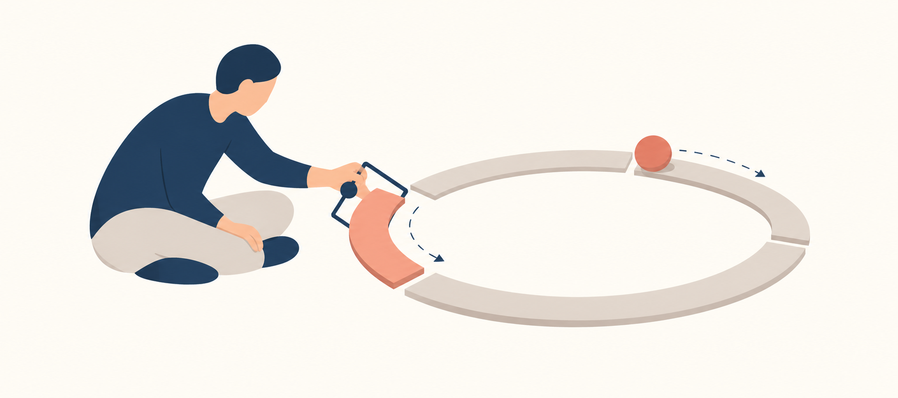

[← 返回总目录](../README.md) · [阅读合并版](../理性生活指南_逐章深度总结.md)

# 第1章深度总结：你可以在多大程度上依赖自我治疗

> **本章定位**：本章不是直接教一套“读完即可自愈”的技巧，而是在回答一个先决问题：一本自助书究竟能帮到什么程度？作者给出的答案既不悲观，也不许诺奇迹——自助能够带来深刻改变，但阅读本身不是改变；真正产生作用的是读者持续进行的自我分析、信念反驳、行为练习与修正。严重或根深蒂固的问题通常仍需要专业治疗。

## 一、本章问题

本章围绕一个表面简单、实际包含多层条件的问题展开：

> **既然理性情绪行为疗法（REBT）的原则可以被写清楚，人是否能够只靠阅读和自我训练，免去心理治疗？**

作者把这个问题拆成四层：

1. **知识层**：读者能否准确理解书中的原则，而不是按自己的旧习惯误读？
2. **行动层**：理解之后，读者是否真的会练习，而不只是口头赞同？
3. **纠错层**：当读者把原则用错时，是否有人或某种机制及时反馈并修正？
4. **改变层**：一次顿悟能否转化为稳定、持久的思考、感受与行为方式？

**原书主张**：自我治疗有明显局限，书籍无法完全替代治疗；但一些人确实能通过阅读、思考和实践获得巨大改变。无论是否接受治疗，真正持久的改变最终都必须包含自我治疗。

**分析性概括**：作者拒绝两个极端——“一本书什么也改变不了”和“理解道理就能治好自己”。更准确的模型是：**自助材料提供方向和工具，个体实践提供改变的动力，反馈与修正决定改变是否走偏，时间与重复决定改变能否稳定。**

## 真实故事：乌玛·查特吉——她已经很努力地控制自己，为什么仍需要专业校准

乌玛·查特吉（Uma Chatterjee）从大约4岁起就反复担心父母会死。为了阻止灾难，她会把祷告循环念39遍。她当时既没有这种症状的名称，也没有向人完整说出自己的恐惧，于是把脑中的念头当成事实，以为生活本来就是这样。[1]

随着年龄增长，这套“只要我足够小心，就能避免灾难”的规则侵入了学习、关系和日常消费。她害怕自己漏掉课堂信息，便逐字记笔记、录下课程，再反复回听；她会在事后逐遍检查谈话和记忆，向别人索取确定答案。行为看似认真，实际却使她无法吸收内容。她逐渐逃课、与人隔离，读心理学两年后以1.83的GPA退学，后来进入伯克利音乐学院，又因症状未受控制而退学。[1]

与后来成为丈夫的扎克共同生活后，问题再也无法藏在个人习惯里。扎克开着灯、正常使用纸巾，都会触发一条迅速升级的推理：“电费会付不起——我们会流落街头——我们会死——而且是我的错。”她独处时用手机手电筒代替开灯，也会坐在自己的双手上，强迫自己不要立刻关灯；但只要扎克没有看见，她仍会去关灯或清点纸巾。一次，扎克吃掉她剩下的土豆泥，她当场痛哭，主观上仿佛“没有这份食物，整个世界就要完了”。这件小事成为清晰的触发点：她终于确认，自己面对的并非普通节俭或意志薄弱，而是严重且失控的问题。[1]

她后来找到国际强迫症基金会的信息，认出自己的表现符合强迫症；但“知道病名”仍没有自动带来正确治疗。她22岁才被诊断，此后又经历了约3年并非针对强迫症的传统认知行为治疗和心理动力治疗。其间，她尝试靠“坐住双手、不做身体动作”来自救，丈夫在身边时还能帮助监督；疫情后丈夫恢复外出工作，她独自在家，身体强迫行为便卷土重来。她由此发现两个盲点：第一，她把强迫行为误解成只有外显动作，漏掉了反刍、回忆检查等心理仪式；第二，停止一个动作并不等于已经理解和切断整个“恐惧—求确定—暂时缓解”的循环。[2]

真正的转折不是她放弃自助，而是她找到懂强迫症的治疗师，把自助纳入专业校准。治疗师与她逐项画出触发因素、强迫性解释和身体或心理仪式之间的地图，再以暴露与反应预防（ERP）训练她：例如故意开灯并离开房间，让“可能浪费、可能出事”的恐惧存在，同时延迟或拒绝关灯这一强迫反应。[1] 开始ERP时，她会哭，也反复觉得退出更容易；但她继续练习，数周内症状开始减轻。后来她重返学校，取得心理学学士和神经科学硕士学位，两项学位均为4.0 GPA，并进入威斯康星大学麦迪逊分校攻读神经科学博士、研究强迫症。[1]

这个结果不是“治愈后从此不再需要帮助”。截至NIMH报道时，她仍在接受ERP以管理症状；她能够结婚、交友、学习和工作，但强迫症并未被叙述成永久消失。[1] 她的故事因此同时证明了自我治疗的能力与局限：本人必须亲自承受不确定感、停止仪式并反复练习；但在错误诊断、错误方法和本人看不见的心理仪式面前，仅靠意志和零散知识可能让人非常努力地在错误位置用力。

### 心理机制

**以下为基于来源的分析，不是乌玛或机构的逐字诊断。**她的核心循环可以概括为：侵入性念头或普通事件触发灾难解释和过度责任感；祷告、记录、回放、求保证、节省或关灯暂时降低焦虑；这种短期缓解反过来强化“刚才确实有危险，幸亏我做了仪式”。同行评审综述指出，强迫和回避正因能短暂减轻焦虑而得到负强化，长期却会加固恐惧以及强迫循环。[3]

她早期的错误解释至少有三层：把念头当事实，把症状造成的学习困难解释为自己“太笨、不属于这里”，又把能忍住可见动作当成已经解决问题。[2] 这与本章的汤姆形成呼应：两人都不是没有行动，而是旧机制借用了一个看似合理的新办法。自助的危险并非只在“什么都不做”，也在于一个人可能忠实执行自己对问题的错误模型。

### 解决方案如何发生

解决方案由四个彼此不能替代的部分组成：

1. **自我识别提供入口**：真实生活中的失控事件促使她搜索资料，并认出强迫症这一可能解释。
2. **专业评估纠正模型**：专科治疗师帮助她识别外显动作之外的心理仪式，画出触发—强迫思维—强迫行为的功能链。[1]
3. **本人完成行为练习**：ERP不是治疗师替她消除恐惧，而是她在指导下主动接触触发物、不以仪式换取确定，并在生活中重复练习。[1][3]
4. **持续管理而非一次毕业**：ERP通常包含逐级暴露、课外练习与复发预防；研究综述也指出，约20%—30%的患者会提前退出，完成治疗者也不一定完全缓解，练习依从性会影响结果。[3]

因此，专业治疗并没有取消她的自我治疗，反而让她终于能够在正确靶点上自我训练。治疗师提供诊断、地图、剂量和反馈；她提供无法外包的练习、忍耐与长期维护。

### 反事实：如果没有这个改变

反事实不能当作已发生的事实，但可以用现有轨迹检验机制。若她继续把问题理解为“我不够聪明”或“我只要再用力忍住动作”，最可能延续的不是稳定康复，而是退学、隔离与仪式反复：她此前已经两次退学，而单靠压住身体动作也曾在外部监督消失后复发。[1][2]

相反，如果她只得到“你有强迫症”这一标签，却没有识别心理仪式、接受针对性的ERP，诊断本身也未必足够——她的真实经历正显示，从确诊到合适治疗之间仍可相隔数年。[2] 但也不能反向断言ERP保证人人达到她的结果：综述显示约三分之二接受ERP者症状改善，约三分之一达到康复标准，仍有人无充分反应或中途退出。[3] 这个边界使故事的结论保持现实：找到有效方法能显著扩大一个人的自助能力，却不能把治疗写成确定成功的个人英雄叙事。

### 来源

[1] **“My Life With OCD”**，美国国家心理健康研究所（National Institute of Mental Health, NIMH），https://www.nimh.nih.gov/news/science-updates/2024/my-life-with-ocd （访问日期：2026-10-11）。

[2] **“OCD myths and realities, with Dean McKay, PhD, and Uma Chatterjee”**，美国心理学会（American Psychological Association），https://www.apa.org/news/podcasts/speaking-of-psychology/obsessive-compulsive-disorder （访问日期：2026-10-11）。

[3] **“Exposure and response prevention for obsessive-compulsive disorder: A review and new directions”**，Dianne M. Hezel、H. Blair Simpson，*Indian Journal of Psychiatry*，https://pmc.ncbi.nlm.nih.gov/articles/PMC6343408/ （访问日期：2026-10-11）。

## 普通人的真实求助现场

> **来源说明**：本案例来自 `ques_ans1.json` 中 `index: 9161`、`ques_id: 8f94fda63365c52699f8bc1dbf176954`，原题为《心理咨询是我的支柱，可家人觉得是忽悠，我恐惧自责？》。以下“提问者经历”属于用户自述；“社区回应”是平台回答者的意见，不是临床评估、诊断或医疗建议，也不能证明提问者后来采取了建议或获得了某种结果。

### 提问者经历

提问者说，自己此前一直在做心理咨询，咨询师的话让自己“感到第一次被理解”，心理咨询也逐渐成为“精神支柱”。生活中遇到烦恼时，提问者会回想咨询师说过的话，并开始尝试与父母沟通。

但在向父亲讲述烦恼和咨询感受后，父亲认为心理咨询师“不说一些好话，你喜欢的话，你会乖乖的去不断预约，付费？”，母亲也认同这一看法。提问者形容自己当时“一阵晕眩，精神支柱崩榻了一样”，像“一个人多年的信仰被摧毁”。此后，咨询师说过的话不再像以前那样使其平静，父亲的质疑“总是在大脑挥之不去”。

提问者把当前感受分成两部分：一是恐惧——担心以后遇到烦恼时“已经沒有精神支柱了”，想反驳父亲，却因父亲事业有成、社会经验丰富而觉得“不容我辨驳”；二是自责——原以为自己对咨询师的信任很牢固，现在却认为这份信任“这么经不起打击”，甚至问自己：“这么缺乏信任感还有什么资格获得別人的帮助。”最后，提问者求助：“我想找回对心理咨询的信任。我想解决我的心理病。”（以上为原提问节选，仅作长度删节，保留原意和关键原话。）

### 社区回应

该问题共有 **69** 条回答。所选回答标记为 **“推荐”**，获 **35** 个赞（0次打赏、6条评论）。回答者先概括提问者像“被两股力量拉扯的孩子，一边是心理咨询师，一边是父母”，随后写道：

> “如果楼主当真觉得咨询对你没有帮助，或者咨询师不合适，完全可以随时退出，不过建议和你的咨询师就你的退出进行讨论。”
>
> “但从楼主提供的文字材料来看，你的确从咨询中获得了一定帮助。”
>
> “楼主想反对父亲，但无法反驳。听起来在这样一个权威形象面前，你所有的不满和愤怒都不得不统统压抑，而它们很可能转而指向了你自己，比如你会因为自己难以信任咨询师而自责。”
>
> “楼主希望大家来帮你做一个决定，但实际上任何人都不可能也没有资格代替你生活，选择属于你的人生。我们不例外，你的咨询师不例外，你的父母也不例外。”

（以上为该回答准确节选。回答中对父母动机、家庭模式及提问者信任关系的解释，是社区回答者的推测，不能视为已经核实的事实。）

### 这一案例显影了什么

这个案例把本章讨论的“自助、专业帮助与本人判断”压缩进了同一个现场。咨询曾给提问者带来被理解感和稳定作用，但这种帮助被体验成一根几乎不能受质疑的“精神支柱”；父亲提出相反判断后，提问者又因父亲的成就和经验而几乎把判断权交给另一位权威。问题因此不只是“咨询师可信还是父亲可信”，而是：**当两个外部权威冲突时，提问者是否拥有一套能够回看事实、评价效果、讨论疑问并自主选择的纠错机制。**

它也显示了本章所说的两种风险。第一，专业帮助若只被当作提供确定感的支柱，当信任发生波动时，原有安定可能随之崩塌；第二，“最终要由自己判断”若被误解成必须独自解决一切，又可能制造新的自责。更稳妥的理解是：咨询关系可以提供理解、反馈和校准，但不能替当事人生活；当事人的自主性也不等于拒绝帮助，而是逐步学会根据实际变化、咨询边界和持续沟通来作判断。

### 若套用本章方法，下一步可怎样观察/行动

以下只是依据本章方法可以尝试的观察路径，不表示提问者已经这样做过：

1. **把事实与结论分开**：分别记录“咨询中具体发生了什么、生活出现过哪些变化”和“咨询师都在骗我”“我这么容易动摇就没资格被帮助”等结论，避免把任何一方的一句话直接当成完整事实。
2. **把怀疑带回咨询关系讨论**：可以原样告诉咨询师父母的质疑、自己的晕眩和信任动摇，观察咨询师能否容纳质疑、说明方法与收费设置、讨论目标和效果，而不是只要求继续相信。
3. **用可观察证据评估帮助**：不只问“我信不信咨询”，还可问：困扰是否更能被识别？沟通、学习、工作或生活功能是否有具体变化？咨询目标是否清楚？停滞或不适能否公开讨论？
4. **检查权威效应与自我贬低**：父亲有社会经验，不等于他对心理咨询的判断必然正确；对咨询师有怀疑，也不等于提问者“不配获得帮助”。可把“我希望得到父亲认可”与“我必须服从父亲判断”区分开。
5. **保留多种选择而非二选一**：根据后续讨论和实际效果，可以继续、调整目标、寻求第二专业意见、更换咨询师或暂停；关键不是由社区、父母或咨询师替自己决定，而是让选择建立在信息、体验、边界和风险评估上。

> **风险提示**：这是一则涉及心理咨询与明显情绪困扰的匿名自述，现有材料不足以判断提问者的诊断、咨询质量或家庭关系。不要仅凭社区回答突然停用药物、终止正在进行的治疗，或把未经核实的动机推测当作事实。若出现自伤或轻生念头、无法维持基本生活、症状急剧加重，或感到自己/他人正处于即时危险中，应尽快联系当地急救、危机干预资源或合格的心理健康专业人员。

---

## 二、具体场景：同一句原则，为什么有人获益，有人却用反了

### 场景1：汤姆——把“不被妻子的愤怒扰乱”误解成“强硬惩罚妻子”

汤姆过去在妻子指责他时会害怕、卑躬屈膝。经过几次治疗，他声称自己已经学会“不再让妻子的愤怒影响自己”。听起来，他似乎掌握了REBT的核心。

但治疗师继续追问他的实际行动，才发现汤姆所谓的进步是：辱骂妻子、威胁打掉她的牙齿，并把这种攻击理解为治疗师鼓励的“有力反击”。

这里暴露出自助或浅层理解最危险的失败方式：

- 他记住了结论：“不要被她影响。”
- 他删掉了条件：“不谴责她这个人，接纳她仍是一个会犯错的人。”
- 他跳过了方法：“理解她愤怒的原因，设法帮助，评估关系是否还能继续。”
- 他用旧模式执行新口号：过去是恐惧性屈从，现在变成敌意性攻击。

**原书给出的修正方向**：汤姆可以不把妻子的反对看得过重，但也不必谴责她。他应尝试接纳她和她的愤怒，在可能的情况下帮助她减少愤怒；如果合理期限内没有改善，就现实地判断自己是否还愿意留在这段关系中。

**分析**：汤姆改变的是行为表面，没有改变底层评价结构。他原来的隐含公式可能是：

> 她责备我 → 这证明我弱小/糟糕 → 我必须屈服。

后来只是变成：

> 她责备我 → 她是糟糕透顶的人 → 我必须压倒或惩罚她。

两者看似相反，底层却相同：都把一次冲突升级为对“整个人”的绝对评价，并把“我不喜欢这种行为”升级成“这种行为绝不能发生”。真正的理性不是从屈服摆到攻击，而是把评价对象从“人的全部价值”缩小到“此时此刻的一项行为”，再根据现实选择沟通、设界限或离开。

### 场景2：斯坦——降低不现实期待后，愤怒显著减少

斯坦与存在明显问题的妻子共同生活了28年，长期对她愤怒。一本书中的一句话触发了他的转变：不要期待一个经常醉酒的人始终表现清醒，也不要期待一个经常做出非理性行为的人时时理智。

他由此意识到，自己一直在向一个经常行为失常的人索取稳定、理智的表现。期待与现实长期冲突，愤怒便反复产生。降低不现实的期待后，他虽然没有变得完全幸福，却能较平静地生活，并更有效地保护孩子。

**原书主张**：通往地狱的道路是由不现实的期待铺就的。

**作者同时纠正了自己的语言**：“酒鬼”“疯狂的人”都是草率的过度泛化。世界上不是存在一种永恒固定的“酒鬼”或“疯子”，而是有人经常过量饮酒或在某些时候表现得疯狂；人仍可能改变。

**分析**：这里有两个必须同时保留的判断：

1. 根据一个人的重复行为，形成现实预期；
2. 不把这种预期固化为对其本质和未来的永久判决。

也就是说：**预期应服从现有证据，但人格判断不能越过证据。**“他近期反复失约，所以重要安排不能依赖他”是现实判断；“他天生就是废物，永远不会改变”则是过度泛化。

### 场景3：鲍勃——一个观念触发广泛的生活改变

鲍勃曾被诊断为偏执型精神分裂症并住院一年半。他长期不与父母说话，婚姻接近破裂，回避讨论令自己尴尬的问题，行为中充满愤怒与自我保护。

后来，他从文章中接受了一个核心观点：

> 人和事情不会直接使我们烦乱；我们关于它们的信念，是造成烦乱的重要原因。

他把它称为“对抗不快乐公式”。随后，他恢复与父母交谈，改善与妻子的相处，开始谈论多年回避的问题，并主动向他人传播理性生活的思想。

**原书主张**：有些人确实能因读到一个重要观念而发生显著转变。读者也可能做到，但并非人人都能或愿意做到。

**分析**：真正改变鲍勃的不是一句话本身，而是他把这句话当作新的行动规则。他没有停在“我认同”，而是立刻用它处理父母、婚姻、羞耻和社交回避。因此，这一案例支持的不是“金句疗法”，而是：**一个被深度接受并跨场景执行的原则，可能成为重组生活的杠杆。**

### 场景4：哲学家——没有现代治疗，也能通过思想与实践改变自己

作者列举芝诺、伊壁鸠鲁、爱比克泰德、马可·奥勒留和斯宾诺莎等理性思想家。他们阅读前人的学说，独立思考，改变原有哲学，并以新的思想指导生活。

**原书主张**：没有现代意义上的心理治疗，人仍可能通过理性反思和实践改变自己；但能做到这种程度的人在人类历史上非常罕见。

**分析**：作者使用这些人物不是为了证明“人人都不需要治疗”，而是反驳“深刻改变只能来自长期治疗”这一绝对命题。少数反例足以证明自我改变是可能的，却不足以证明它对所有人都同样容易。

---

## 三、第一性原理：自我治疗为什么可能，又为什么常常失败

先把“治疗”这个大词暂时拿掉，只看最小机制。

一个人遭遇事件后，并不是从事件直接跳到持久情绪和行动，中间至少存在一个评价环节：

> **外部事件 A → 我对事件的信念/评价 B → 情绪与行为后果 C**

例如：

> 妻子批评我 → “她绝不能这样；她这样就证明我很无能” → 恐惧、屈从或攻击

如果只改变外部事件，而不改变评价方式，相似的痛苦很可能在下一次事件中重现。反过来，如果能发现并反驳绝对化、灾难化、贬低自我或他人的信念，情绪和行为就可能改变。

### 最小因果链

本章隐含的完整改变链可以写成：

> **接触新原则** 
> → **准确理解原则及其条件** 
> → **识别自己在具体情境中的非理性信念** 
> → **有力反驳，而非口头重复理性句子** 
> → **采取与新信念一致的新行为** 
> → **观察结果并接受反馈** 
> → **修正误解和错误应用** 
> → **跨情境、反复练习** 
> → **形成较稳定的新思考—感受—行为模式**

自我治疗之所以**可能**，是因为这条链上的关键工作——观察自己的信念、检验它、练习新行为——最终只能由本人完成。治疗师无法进入一个人的头脑替他思考，也无法替他在两次会谈之间生活。

自我治疗之所以**常常失败**，是因为这条链很容易在任何一环断裂：

1. **误读**：只挑自己喜欢的部分，删掉“如果、并且、但是”。
2. **口头认同**：把“我觉得很有道理”误当成已经改变。
3. **旧模式挟持新语言**：像汤姆一样，用“理性”包装攻击。
4. **缺乏行为实验**：从不冒险、不沟通、不设界限，也不面对回避之事。
5. **缺乏反馈**：误用原则后没人追问“你实际上做了什么”。
6. **缺乏重复**：一次顿悟没有经过退步、修正和再练习。
7. **问题强度超过自助能力**：严重、长期、根深蒂固的困扰可能需要有能力的治疗师系统介入。

### 专业治疗的最小功能

本章并未把治疗师描写成“替你治好的人”。治疗师更像一个外部校准系统，主要提供四种功能：

- **显影**：指出你正在如何制造或加剧情绪困扰；
- **翻译**：把抽象原则落到你的具体事件、信念和行为上；
- **纠偏**：发现你误解、过度简化或反向使用原则；
- **推动**：布置并检查家庭作业，促使你实际冒险、想象、反驳和练习。

因此，专业治疗与自我治疗不是互斥关系。REBT治疗本身就把大量改变工作交给当事人在两次治疗之间完成。

---

## 四、普林斯顿式内心推理路径：当我想靠一本书改变自己时，脑中该怎么走

下面不是原书逐字列出的步骤，而是根据本章案例提炼的实践性推理路径。

### 第一步：先别问“这句话对不对”，先问“我准备怎样使用它”

我读到一句很有力量的话，第一反应可能是：“太对了，这解释了我的人生。”但汤姆的案例提醒我，仅仅觉得正确没有意义，甚至可能危险。于是我要追问：

- 下一次同类事件发生时，我具体会说什么、做什么？
- 这个行动是在减少绝对化和谴责，还是只让我更有理由攻击别人？

如果新观念只增加了我的优越感，却没有增加现实感、接纳能力和有效行动，我很可能用错了。

### 第二步：把“谁害我痛苦”改写成“我对这件事加了什么判断”

我不是否认别人可能伤害、控制或不公正地对待我。外部事件确实会带来损失和困难。但我现在要找的是：在事实损失之外，我是否又加了一层绝对要求？

例如：

- 事实：“她批评了我。”
- 偏好：“我很希望她不要这样。”
- 绝对要求：“她绝不能这样；她这样我就受不了。”
- 全面贬低：“她这样做，所以她整个人就是恶人；我被批评，所以我毫无价值。”

我现在关心的不是强迫自己喜欢批评，而是拆掉“绝不能、受不了、整个人都糟透了”这些额外放大器。

### 第三步：区分接纳与纵容

这里很容易错。接纳一个会犯错的人，不等于赞成他的行为，也不等于继续忍受伤害。

我可以同时说：

- “她是一个会有问题、会做错事的人，我不把她的全部价值等同于这次行为。”
- “这种行为对我不利，我会沟通、设界限；若长期不变，我会考虑离开。”

这比两个极端更理性：一个极端是“为了接纳，我什么都忍”；另一个极端是“为了保护自己，我必须把她判成坏人并惩罚她”。

### 第四步：检查我的期待是否以现实为依据

如果一个人过去长期反复出现某种行为，我却每次都要求他下一刻必须完全相反，我的期待就在持续制造额外愤怒。

所以我会问：

- 根据已有证据，他目前最可能怎么做？
- 我能否为这个概率做准备，而不是要求现实服从我的愿望？
- 我是否又把“目前大概率如此”说成“他永远只能如此”？

现实预期不是宿命论。它允许改变，但不拿尚未发生的改变当作今天的计划基础。

### 第五步：把理解变成一次可观察的行为实验

如果我说自己学会了某个原则，就要让它在行为中留下证据。例如：

- 以前回避某个谈话，这周进行一次十分钟的诚实交流；
- 以前一被否定就攻击，这次先描述行为和影响，不评价对方整个人；
- 以前认定焦虑“无法忍受”，这次带着焦虑完成一个小任务；
- 以前只读书，这次写下事件—信念—后果，并对信念逐句反驳。

没有行为证据的理解，暂时只能叫“听懂了”。

### 第六步：主动寻找纠错，而不是寻找认同

我很容易把任何结果解释成自己已经进步。因此要设置一个反迎合问题：

> 如果治疗师像追问汤姆那样问我“你究竟做了什么”，我的回答会显示出接纳、现实和有效行动，还是显示出回避、报复与贴标签？

如果我无法自行判断，或反复陷入同一模式，就需要外部反馈，必要时寻求专业帮助。

### 第七步：预期退步，把重复当作机制而不是失败

汤姆不是听一次解释就彻底改变，而是经历更多教导、退步和重新实践。于是我不该把复发理解为“方法无效”或“我不可救药”。更准确的判断是：旧模式练习了很多年，新模式需要多轮识别、反驳和行动才能竞争过它。

---

## 五、反事实与边界检验

### 检验1：如果“理解道理”本身就足够，汤姆应该发生什么？

**反事实设定**：只要听懂“不被妻子的愤怒扰乱”，人就会自然采取理性行动。

**应有结果**：汤姆在复述原则后，应能平静沟通、停止自我贬低，也停止谴责妻子。

**实际结果**：他把原则转译成威胁和攻击。

**结论**：能复述原则不能证明准确理解，更不能证明已经形成相应行为。理解必须由具体行为、反馈和后果来检验。

### 检验2：如果外部事件直接、必然决定情绪，斯坦的愤怒能否在妻子没有改变时下降？

**反事实设定**：妻子的行为是斯坦愤怒的充分且直接原因，只要她不变，他就不可能明显减少愤怒。

**实际结果**：妻子的情况并未被描述为发生根本改变，但斯坦调整期待后，愤怒几乎消失，行为更理智。

**结论**：外部事件重要，却不是情绪结果的唯一变量；个体对事件的期待和评价能够显著改变情绪后果。

**边界提醒**：这不表示外部伤害可以忽略，也不表示受害者应为一切痛苦负责。改变内在信念是为了减少额外的自我折磨，并提高现实行动能力，不是替伤害者免责。

### 检验3：如果自助必然无效，鲍勃和历史上的理性思想家如何解释？

**反事实设定**：没有长期个人治疗，就不可能发生基本态度与行为的深刻改变。

**实际结果**：鲍勃通过阅读和实践发生广泛改变；历史上也有人借由哲学思考重塑生活。

**结论**：专业治疗不是所有深刻改变的必要条件。

**边界提醒**：这些成功案例证明“可能”，不证明“普遍、容易或对任何严重程度都足够”。作者明确认为，多数有严重情绪问题的人仅靠自助难以解决。

### 检验4：如果接纳意味着容忍一切，汤姆理性后是否只能继续留在关系中？

**反事实设定**：不谴责妻子，就必须接受她持续的糟糕行为并永不离开。

**原书给出的边界**：汤姆可以尝试理解和帮助；若合理时间内无改善，他应现实地决定是否继续共同生活。

**结论**：无条件接纳“人”不等于无条件接受“行为”或“关系安排”。理性可以导向留下，也可以导向设限或离开，关键是决定不由绝对化愤怒和人格谴责支配。

### 检验5：如果一个人的重复行为代表其固定本质，还需要保留改变可能吗？

**反事实设定**：“酒鬼”“疯子”等标签准确描述了一个永久不变的人格实体。

**问题**：这会推出他总是、只会如此，未来改变不可能。

**原书纠正**：人是在某些时候做出醉酒或疯狂表现；有人能够清醒，也有人能通过训练减少非理性行为。

**结论**：可以依据重复行为预测近期风险，但不能把行为频率偷换成本质恒定。理性预期需要同时容纳统计规律与改变可能。

---

## 六、容易误解之处

### 误解1：“人和事不会使我烦乱”＝外界伤害不存在

不是。原书强调信念在情绪困扰中的作用，并未否认现实事件会造成损失、疼痛和困难。这里需要区分：

- **现实的不利后果**：受伤、失去工作、关系破裂；
- **附加的自我困扰**：“这绝不能发生”“发生了我就彻底完了”“这证明我毫无价值”。

REBT主要试图减少第二层，以便人更有效地处理第一层。

### 误解2：不被别人影响＝压过别人、惩罚别人

汤姆正是这样误用。减少恐惧不自动等于增加理性；一个人可以从顺从跳到攻击，却仍被绝对要求和全面谴责控制。

### 误解3：接纳别人＝赞成别人或永远留在有害关系中

接纳是拒绝把一个人的全部价值等同于某项行为；赞成是认为该行为正确；继续关系则是现实决策。三者不是一回事。

### 误解4：降低期待＝悲观、认命

斯坦的例子不是要求人相信对方永远不会改变，而是不要在缺少证据时，把“对方必须立即变好”当作情绪稳定的前提。现实预期反而能帮助人更有效地保护自己和孩子。

### 误解5：读懂并赞同＝已经发生改变

作者尤其警惕“口头上的赞成”。真正的指标是：是否识别自己的失败模式，是否反驳非理性信念，是否采取新行动，是否在退步后继续练习。

### 误解6：一次顿悟＝永久治愈

斯坦和鲍勃的案例说明顿悟可能产生巨大影响，但汤姆的案例显示，改变往往需要重复、实验和修正。本章没有保证所有顿悟都可靠或持久。

### 误解7：治疗师能替我完成改变

治疗师可以帮助识别、解释、纠偏和推动，但无法代替当事人思考和生活。若当事人不持续投入，治疗也可能只带来表面、短暂的改善。

### 误解8：既然最终靠自己，就不需要治疗师

“最终工作由自己完成”不等于“外部帮助没有价值”。正因为人会误读、自欺和退缩，治疗师的反馈系统才重要。尤其是严重、长期、根深蒂固的问题，作者明确建议与有能力的治疗师深入接触。

### 误解9：给人贴固定标签能帮助我接受现实

“他目前经常这样做”与“他本质上就是这种人”不同。前者是行为描述和风险判断，后者容易滑向过度泛化，抹掉情境差异和改变可能。

### 误解10：这是一套盲目乐观或严格禁欲的斯多葛口号

作者明确警告，语言容易让人把书中的概念误听成早已拒绝过的陈词滥调。正确态度不是先崇拜或先否定，而是理解其条件、付诸实践、观察结果并检验。

---

## 七、可执行练习

### 练习1：把“赞同”转换成行为证据

从本章选一句你最赞同的话，完成下面四栏：

1. **我赞同的原则**：例如“治疗师不能代替我思考”。
2. **旧行为**：我过去在什么场景中把责任交给别人？
3. **本周新行为**：一个具体、可观察、十分钟到一小时内能完成的动作。
4. **检验标准**：做完后，什么证据说明我不是只在口头赞同？

不要写“我要更理性”，要写“下次被批评时，我先记录自己的第一句自动想法，十分钟后再回复”。

### 练习2：事件—信念—后果拆解

选择最近一次强烈情绪，写下：

- **A，事件**：只写摄像机能拍到的事实，不加评价。
- **B，信念**：我要求什么“必须”发生？我把什么说成“受不了”？我是否贬低了自己或他人的全部价值？
- **C，后果**：情绪是什么？随后采取了什么行动？
- **D，反驳**：这个要求符合逻辑和事实吗？它是否有用？偏好能否替代绝对要求？
- **E，新效果**：更合理的情绪和行为可能是什么？

示例：

> A：伴侣批评我花钱接受咨询。 
> B：她绝不能反对我；她反对就说明她糟透了，或者说明我做错了。 
> C：恐惧后转为攻击。 
> D：我希望她理解，但她没有义务永远同意；她这次的行为可能不合理，却不能定义她全部，也不能定义我。 
> E：失望或烦恼，但能说明理由、询问担忧、设定谈话边界。

### 练习3：汤姆测试——检查自己是否用理性包装攻击

回顾一次你认为自己“终于强硬起来”的事件，回答：

- 我描述的是对方的具体行为，还是给整个人贴标签？
- 我在保护边界，还是在追求让对方受罚？
- 我的行动能改善现实，还是只带来短暂的胜利感？
- 如果不谴责对方，我仍可以采取什么坚定行动？

### 练习4：现实期待校准

选一个反复令你失望的人或情境：

1. 写下过去三到五次实际发生了什么；
2. 根据记录预测下一次最可能发生什么；
3. 为最可能情况准备一个应对方案；
4. 再写一句保留变化可能的话，例如：“这是当前概率，不是他的永久本质。”

目标不是降低一切标准，而是让计划建立在证据上。

### 练习5：行为描述替代人格标签

把以下句型中的固定标签改成可观察行为：

- “他就是一个酒鬼” → “他过去一个月有五晚饮酒后失控。”
- “她是疯子” → “她在冲突中多次大喊、指控并拒绝听取解释。”
- “我是失败者” → “我这次考试没有达到目标，而且之前准备不足。”

然后补两句：

- **现实预期**：“基于这些记录，近期我需要防范……”
- **改变可能**：“如果出现哪些持续证据，我会更新判断……”

### 练习6：为自助设置纠错回路

每周一次，回答：

1. 我这周应用了哪个原则？
2. 我具体做了什么？
3. 结果是什么？
4. 我是否把原则用来回避、攻击、自责或证明自己正确？
5. 下一轮只改哪一个动作？

如果连续数周没有实际行动，说明你目前进行的是“阅读”，还不是“自我治疗”。

### 练习7：判断何时需要外部帮助

出现下列情况时，不要把“必须全靠自己”变成新的绝对要求：

- 困扰严重、长期存在并明显损害工作、关系或基本生活；
- 反复误用原则，无法辨认自己的盲点；
- 明知应该行动，却长期无法开始或持续；
- 症状、冲动或风险超出自助材料能安全处理的范围；
- 每次短暂改善后都迅速回到原有模式。

本章的立场不是“依赖治疗”或“拒绝治疗”，而是根据问题强度和自我纠错能力，现实地组合自助与专业帮助。

---

## 八、本章结论

**原书主张的核心**：

- 一本书无法治愈所有情绪问题，也不能替代针对独特个体的个人辅导。
- 多数严重或根深蒂固的情绪问题需要持续、专业的治疗支持。
- 但自助确实能帮助一些人，甚至可能触发深刻变化。
- 即使接受了优秀治疗，若本人不进行持续、有力的自我分析和实践，改善也往往浅表而短暂。
- REBT因此不是“治疗师对当事人做什么”，而是治疗师帮助当事人学会独立识别、反驳和改变自己的失败模式。
- 改变需要的不是简单阅读，而是认识旧模式、积极反驳非理性信念，并反复学习新的思考、感受和行为方式。

**分析性总括**：

自我治疗的真正单位不是“一本书”或“一次顿悟”，而是一个可重复的纠错循环：

> **看见旧信念 → 检验旧信念 → 采取新行动 → 接受现实反馈 → 修正理解 → 再次练习。**

书能提供地图，治疗师能帮助校准方向，但路仍必须由本人反复走。反过来，自己走路也不意味着必须拒绝地图、路标或向导。

## 一句话触发器

> **每当我说“我已经懂了”，立刻追问：下一次同类事件发生时，我会具体怎样想、怎样做，又用什么证据证明我没有把这个原则用反？**

---

[← 返回总目录](../README.md)
