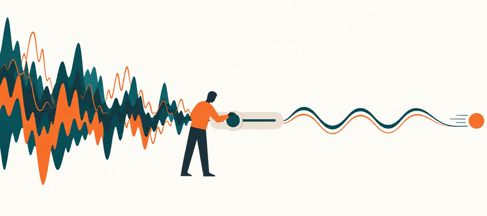

[← 返回总目录](../README.md) · [阅读合并版](../理性生活指南_逐章深度总结.md)

# 第3章深度总结：通过清晰的思考获得良好的感觉

> **范围说明**：本总结只依据所提供的第3章文本。以下明确区分“原书主张”与“分析性重构”。原书在本章末尾提出“为什么理性情绪行为疗法把思考放在最重要的位置”，但尚未完整回答；不能把后续章节的内容倒填进来。

## 一、本章问题

本章围绕三个层层推进的问题展开：

1. **理性地组织和控制思想，会不会把人变成冷淡、机械、缺乏激情的人？**
2. **强烈情绪是否天然不健康，理性是否意味着压低情绪强度？**
3. **既然感知、情感、行动和思考彼此交织，理性情绪行为疗法为什么仍把“思考”放在关键位置？**

原书给出的核心方向不是“用理智消灭感情”，而是：

> 清晰、现实的思考主要削弱的是对自身不利、具有破坏性的情绪，而不是一切强烈情绪；健康而强烈的爱、快乐、悲伤和遗憾都可以与理性共存，并服务于人的价值和目标。

但原书也保持了一个重要限度：**“感觉在很大程度上来自思考”不等于“人能够或应该用理智控制所有情绪”。**

---

## 证据案例：射箭失准后，她没有变得“毫无感觉”，而是把恐慌改造成可用的紧张

> **证据性质说明**：下述“Zara”是同行评议个案研究中使用的化名，不是为本章虚构的人物。研究对象是一名国家级精英射箭运动员；研究记录了她接受干预前后的量表、自述与比赛成绩。单一个案可以说明一条机制怎样在真实生活中运作，但不能单独证明它适用于所有人。[1][2]

### 1. 触发：越是“理应轻松”的比赛，她越容易崩

Zara在难度更高、对手更强、外界期待较低的户外比赛中往往发挥不错；反而到了她认为距离更短、条件更好、自己“应该”射得更好的室内比赛，表现会恶化。一次比赛上午60箭尚好，下午60箭中出现偏离甚至脱靶。她检查器材没有发现问题，看到其他射手也对她的失误感到惊讶，胃里难受得像发生了大事。她知道别人会说“这不是世界末日”，但当时主观感受恰恰接近“世界末日”。[1]

这就是明确的**触发事件**：并非抽象的“比赛压力”，而是“在本应容易的比赛里，几支箭突然射坏”。真正把它放大的，是随即出现的自动判断：

> “这种容易的比赛我必须射好；如果没有射好，那就太可怕了，而且我承受不了。”[1]

她不是单纯地重视成绩，而是把“我很想射好”升级成“我必须射好”。一旦现实不服从这个要求，一支坏箭便不再只是需要修正的技术信息，而像是对自身能力和局面的全面判决。

### 2. 情绪与行为：问题不是“有负面情绪”，而是情绪让恢复能力失效

Zara在赛前和比赛中出现强烈焦虑，觉得自己无法控制情绪；小失误后容易继续出错，形成“失误—惊慌—更多失误”的连锁反应。[1] 这正好显示健康负面情绪与破坏性情绪的功能差别：

- **健康的紧张、担忧或失望**仍承认“这很重要、这次很糟”，但会把注意力送回下一箭、动作与问题解决；
- **破坏性的焦虑**则附加“绝不能失败、失败太可怕、我受不了”，使身体唤醒、反刍和控制感下降，反过来妨碍目标。

研究文献把前者称为健康负面情绪：它可以不愉快，甚至很强，却倾向于促成适应性行动；后者与回避、逃离等不利于目标的行为更相关。二者未必只是同一种情绪的“低强度版”和“高强度版”，也可能是具有不同心理与行动倾向的情绪。[2][3]

### 3. 转折：目标不是说服她“你其实射得很好”

干预的关键转折很反直觉：治疗者没有先否认失误，也没有要求Zara积极暗示“我一定会赢”。相反，他们暂时接受最坏情况——这次确实可能射坏——再追问：**即使射坏了，为什么它就必然是灾难、必然无法承受？** 这种做法避免把稳定建立在“坏事不会发生”上；如果坏事真的发生，她仍有办法行动。[1][4]

Zara接受了持续3个月、共7次、每次约60分钟的一对一REBT干预，过程包括：[1]

1. **教育与记录**：用ABC框架区分触发事件、信念与情绪/行为结果，并以日记记录自动判断；
2. **逻辑、证据与实用性辩论**：检查“我想射好，所以我必须射好”是否逻辑成立、是否有现实证据、是否真正帮助发挥；
3. **重写判断**：把绝对要求改为强烈但有弹性的偏好，例如“我非常想射好，但不等于我必须射好；射坏很糟，却不是世界末日，我能够承受并继续处理”；
4. **比例校准**：用“坏事量表”把脱靶与丧亲等重大逆境放在同一尺度比较，纠正灾难化；
5. **行为和情绪练习**：反复做ABCDE作业、携带理性应对句、练习理性情绪想象，并通过角色互换让她自己识别和反驳非理性信念。

她为自己设定的新目标并非“比赛时完全不紧张”，而是从极端焦虑转为仍然在意成绩的**功能性紧张**，在失误后更快恢复动作和注意力。她后来把这概括为“缩短低谷”：不是保证不再射出坏箭，而是不让六次错误扩展成整场失控。[1]

### 4. 结果：负面情绪仍在，功能发生了变化

干预后，Zara报告自己遇到小问题时不再那么焦虑，能够借助应对句恢复；她也明确说，更放松的态度没有削弱动机，反而让她更享受比赛、更能把负面事件放回合适比例。[1] 量表显示，她的非理性信念下降、理性信念上升，变化维持到3个月和6个月随访；10项自我效能与控制感指标也出现短期和长期改善。[1][2]

研究还报告：干预前9场与干预后9场比赛相比，她的平均“最高可能得分百分比”从75.64升至84.88，提高9.24个百分点。[1] 这个结果与本章观点相符：清晰思考没有删除她对射箭的重视，也没有把她变得冷漠；它削弱的是“必须成功—失败即灾难—我无法承受”这条使人失控的链，让紧张保留其提醒功能，而不再接管后续行为。

### 5. 心理机制：从“一次坏箭”到“整个人和整场比赛完了”

这个案例可以拆成两条并行路径：

**破坏性路径**

坏箭/脱靶
→ “容易的比赛我必须射好”
→ “没射好太可怕，我受不了”
→ 强烈焦虑、胃部不适、控制感下降
→ 反刍前一箭，连续犯错
→ 把后续失误当作原判断的证据

**健康负面情绪路径**

坏箭/脱靶
→ “我非常希望射好，但现实没有义务保证；这很糟，却可承受”
→ 紧张、担忧或失望仍然存在
→ 注意问题、恢复动作、继续比赛
→ 即使结果不理想，也不把一次表现升级为总体人格判决

这里改变的不是事实A，而是评价B；结果也不是从负面情绪直接跳到快乐，而是从妨碍行动的焦虑转向服务目标的紧张、担忧和失望。REBT研究把这种转化视为核心：弹性、符合现实的信念更可能产生健康负面情绪及适应性行为，绝对化、灾难化和自我贬低则更可能产生不健康负面情绪与目标破坏行为。[2][3][5]

### 6. 可迁移的解决路径

遇到类似场景时，可以按以下顺序处理：

1. **先保留现实问题**：承认“我确实失误了”“结果确实重要”，不要用虚假乐观抹掉事实。
2. **抓住从愿望到命令的跳跃**：寻找“我想要，所以必须”“事情不好，所以糟透了”“我失败，所以我是失败者”。
3. **做三重检验**：它有证据吗？逻辑上能从“想要”推出“必须”吗？相信它会帮助还是妨碍下一步？
4. **写出不粉饰的替代句**：“这很坏，但不是一切都坏；我不喜欢，也能承受；这次行为可评价，整个人不因此定性。”
5. **指定一个恢复动作**：下一箭、下一次沟通、下一份修改，而不是继续审判自己。
6. **允许健康的不舒服存在**：目标是把恐慌变担忧、把崩溃变失望、把自我定罪变具体遗憾，不是强迫自己高兴。
7. **用记录和重复巩固**：系统综述发现，采用ABC框架、反驳非理性信念、强化理性信念并布置练习，是REBT研究中常见的干预组成；较长干预和受训实践者往往与更成功结果相伴，但研究质量在不同领域并不一致。[5]

### 7. 反事实：如果只让她“冷静点”或证明她不会失误

- **只说“别紧张”**：没有处理“我必须成功”的要求；紧张本身还会成为新的威胁——“我连冷静都做不到”。
- **只证明“你其实很优秀”**：短期可能舒服，但把安全感继续押在表现良好上；下一次真实失误仍可能击穿它。
- **把所有负面情绪消除**：她可能同时失去对偏差的敏感、对成绩的重视与修正动作的动力。
- **保留失望、取消灾难化**：她仍知道坏箭不好，却能把精力用于恢复。这才是该案例支持的“清晰思考带来良好感觉”——不是感觉永远良好，而是感觉更符合事实、更能服务目标。

### 8. 局限：这个故事能说明什么，不能说明什么

这是单一个案，没有随机对照组；成绩提高可能同时受到训练、状态、比赛条件等因素影响，不能把9.24个百分点全部归因于REBT。部分关键指标来自当事人自评，研究者本人参与干预，也可能产生期待或报告偏差。论文作者因此把因果结论称为暂定性的，并建议用更严格的单一个案设计和实验研究复核。[1] 更广泛的2024年系统综述纳入162项测量理性/非理性信念变化的REBT研究，总体上发现信念和心理健康结局改善，但指出多数领域的方法学质量偏低、干预报告不完整；运动与锻炼领域平均质量相对较好，也仍不足以把一个成功故事当作普遍保证。[5]

作为交叉核验，另一项对3名半职业综合格斗运动员的单一个案研究呈现了“不整齐的现实”：4次视频REBT后，3人无条件自我接纳均提高，但只有2人的自我贬低下降并维持至6个月；第1人的非理性信念变化很小且未完成随访量表。作者还指出，前后变化的效应量多为小到中等，可靠变化指标总体未达到显著标准。[6][7] 这提醒我们：解决路径值得实验，但不应被写成“换一句想法就必然治好”的神话。

### 来源（访问日期：2026-10-11）

[1] Wood, A. G., Barker, J. B., & Turner, M. J. *Developing Performance Using Rational Emotive Behavior Therapy (REBT): A Case Study With an Elite Archer*（作者接受稿全文）. https://eprints.staffs.ac.uk/2835/1/2835.pdf

[2] University of Staffordshire STORE 条目与摘要（论文元数据、随访与结果概览）. https://eprints.staffs.ac.uk/2835

[3] Turner, M. J. *Rational Emotive Behavior Therapy (REBT), Irrational and Rational Beliefs, and the Mental Health of Athletes*. Frontiers in Psychology, 2016. https://pmc.ncbi.nlm.nih.gov/articles/PMC5028385/

[4] Albert Ellis Institute. *Revisiting the “A”*（最坏情境、健康担忧与破坏性焦虑的区分）. https://albertellis.org/2014/11/revisiting

[5] King, A. M., et al. *A systematic review of the nature and efficacy of Rational Emotive Behaviour Therapy interventions*. PLOS ONE, 2024. https://pmc.ncbi.nlm.nih.gov/articles/PMC11232995/

[6] Cunningham, R., & Turner, M. J. *Using Rational Emotive Behavior Therapy (REBT) with Mixed Martial Arts (MMA) Athletes to Reduce Irrational Beliefs and Increase Unconditional Self-Acceptance*（全文）. https://www.cie-dc.com/uploads/1/3/2/9/132987652/mma9.pdf

[7] University of Staffordshire STORE 条目与摘要（MMA研究元数据与结果概览）. https://eprints.staffs.ac.uk/2831

---

## 普通人的真实求助现场：一件旧事，怎样被反刍扩写成“我以后会不会成为坏人”

> **材料性质说明**：以下内容来自本地问答数据集中的真实求助记录。它只保存了求助者当时的自述和一则社区回应，没有后续追踪，因而不能据此判断建议是否被采纳、反刍是否减轻，更不能把社区回答当作治疗效果证据。

### 1. 原始处境：后悔的不只是一件事，而是它仿佛在预告“我会变成谁”

求助者回忆，初中住在姑姑家时，因为觉得自己的衣服“特别土”，拿了姐姐的衣服；后来觉得不妥，把衣服塞进箱子，临走前向姑姑提了一句。多年后，这段记忆反复回来。她写道：

> “我现在想起来我感觉我自己在偷东西，然后，我就感觉特别愧疚，特别愧疚。”

真正使痛苦继续扩大的，不只是对当时行为的后悔，而是从旧事向未来身份的推演：

> “人家不是说什么小时候偷东西，长大就会有小偷小摸那种不好的习惯，我老想着我长大会不会也这样？”

她已经知道“一件事不能整个否定自己”，但这种道理没有自动终止循环：

> “虽然我知道不能说因为一件事就整个否定自己啊，但还是控制不住的一直去想一直去想。”

而且，这并非唯一一次：

> “以前也经常这样因为各种事感到后悔根本控制不住。”

这段自述把“清晰思考”为什么不同于单纯懂道理显影出来：一个人可以在抽象层面接受“一次行为不等于整个人”，却仍在具体记忆出现时，把事实、推论、人格判决和未来预测重新粘在一起。

### 2. 把反刍中的四层内容拆开

**第一层：可由自述支持的事实**

- 初中时，她在姑姑家拿了姐姐的衣服。
- 她后来觉得这样做不好，把衣服放进箱子，并在离开前向姑姑提过此事。
- 姑姑当时没有明确说什么。
- 多年后，她反复想起此事，并报告强烈愧疚和难以停止的后悔。

**第二层：对他人心理和事件性质的推论**

- “我感觉我姑姑不太高兴”是对姑姑内心状态的推测；记录里没有姑姑的直接表述。
- “我感觉我自己在偷东西”是求助者对当时行为的道德与概念判断，不等同于数据已经核定了行为的全部情境、意图和性质。

这不是说行为无需评价，而是先区分：**可以批评一个具体行为，不必把推测写成已经查明的事实。**

**第三层：对整个人格的判决**

- 从“我当时拿了衣服”滑向“这说明我是会偷东西的那类人”，就不再只是评价行为，而是在用一个少年时期的片段概括完整人格。
- 求助者自己已觉察到这一跳跃，所以才说“不能因为一件事就整个否定自己”；但反刍会不断把已拆开的两者重新合并。

**第四层：关于未来的预测**

- “小时候有过这种行为，长大就会形成小偷小摸的习惯”是一条未来预测。
- 这段记录只提供了一次旧事和当下担忧，没有提供她后来持续出现同类行为的证据，因此不能从中推出“长大一定会这样”。

四层一旦粘连，循环就可能变成：

旧记忆浮现
→ 重放当时细节
→ 推测姑姑的不满
→ 给行为下结论
→ 把行为扩大为人格判决
→ 预测未来会成为更坏的人
→ 愧疚和恐惧增强
→ 因为情绪很强，再把它当成“判断一定是真的”的证据
→ 继续回想和检查

这里的反刍看似在“认真反省”，实际却没有增加多少新事实。它主要反复加工同一材料，并把一次行为扩写成完整人格和未来命运。清晰思考并不是替当时行为开脱，而是让每一层判断只承担其证据能够支持的重量。

### 3. 社区回应：它提供的是观察方向，不是已经验证的结果

被选中的社区回答先承认困扰，并尝试扩大情绪辨认范围：

> “我想在你的感觉中除了后悔之外，这件事也许还会带给你其他的感觉吧？例如羞愧，例如自责。”

回答者还询问反刍出现时是否伴随特定情境或情绪状态：

> “不知道你常常在因为类似事件而产生困扰的时候有没有一些特殊的事情发生呢？例如你的情绪状态是怎么样的？例如有没有发生一些什么事情？”

最后，回答者建议减少对念头与情绪的强制要求：

> “有很多事情发生也就发生了，有些念头产生也就产生了，有些情绪受影响也就受影响了，不要求，不设定，反而会让自己生活更舒服更轻松。”

这则回应的价值在于提出两个可观察方向：反刍是否有触发条件，以及“必须立刻不再想”的要求会不会成为第二层压力。但数据没有显示求助者之后怎样做，也没有显示“放下要求”是否真的让她更轻松。点赞数只能表示社区认可，不能证明建议有效。

### 4. 如果把它当作一次清晰思考练习

下面只能写成待检验的假设，而不是对求助者结果的描述：

- 如果她再次想起旧事，或许可以先只写可观察事实，再分别标出“我推测姑姑不高兴”“我把行为解释为偷窃”“我由此判定自己是什么人”“我预测未来会怎样”。
- 如果她把“我做过一件自己现在不认同的事”与“我是一个注定会持续这样做的人”分开，愧疚或许仍会存在，但未必需要升级为整体自我定罪。
- 如果反复回想并没有带来新证据、补救方案或价值选择，或许可以把这一次心智活动暂时标记为“正在重复审判”，而不是继续把重复本身视为负责。
- 如果现实中仍有合适且不会造成额外伤害的补救空间，她或许可以评估是否需要澄清、道歉或用当下行为兑现诚实；如果没有可行补救，下一步也只能是观察自己现在怎样行动，而不能回到过去重写事件。

这些假设不保证情绪消失。本章的机制只支持一个更有限的目标：让遗憾对应具体行为，让未知保持未知，让未来预测保持为预测，不让一次旧事自动取得定义整个人的权力。

### 5. 风险边界与数据来源

- 数据记录未标注自伤、伤人、虐待或急性医疗风险（`risk_flags: []`）。
- 但“根本控制不住”“一直去想”提示反刍已造成明显主观困扰；仅凭这段文字无法判断其频率、持续时间、功能损害，也不能作出强迫、焦虑或抑郁等诊断。
- 如果类似反刍持续显著影响睡眠、学习、工作或日常功能，或伴随自伤念头、无法保证安全等情况，社区讨论不能替代专业评估；出现即时安全风险时应优先联系当地紧急服务或可信赖的现实支持者。

**数据来源**：`ques_ans1.json`；`index: 94319`；`ques_id: a2b74300cde99360e2abacd576d9c8f7`；标题：“总后悔以前做过的事，道理都懂但还是控制不住地去想？”；共记录8条回答，本节引用其中标记为“推荐”的回答（赞6、赏0、评论0）。引文按原记录节选，省略部分未改变上述语义。

---

## 二、具体场景：质疑者为什么觉得“理性会使人冷漠”

原书以一段持续的对话展开。质疑者听到“组织和控制思想”“理性和现实地生活”时，脑中浮现的是一种冷静、机械、压抑情绪的生活。他们担心：

- 如果理智能影响强烈情绪，那么它会不会阻碍强烈情绪？
- 如果破坏性情绪减少了，是否等于所有激情都被削弱？
- 如果人生不再像过山车一样在抑郁、狂喜和绝望之间剧烈摆动，是否还算真正活过？

原书指出，这种担心受到父母、教师、治疗师以及文学戏剧叙事的影响：人们容易把“纵情生活”与“情绪过度”绑定，把大起大落误认为生命强度的证明。

### 场景一：强烈而健康的爱

一个人重视爱，并遇到符合自己偏好的人，于是强烈地爱上对方。他亲切地对待恋人，建立稳定陪伴，并因此更努力地工作、写诗或从事富有成效的活动。

- **情绪强度**：很高。
- **是否理性兼容**：可以兼容。
- **功能结果**：推动亲密、创造和建设性行动。

这个例子用来说明：**“强烈”与“有害”不是同义词。**

### 场景二：悲伤和遗憾作为信号

失败或被拒绝会带来强烈的悲伤、遗憾。原书没有要求人消除这些不愉快感受，而是提出：如果把它们理解为“事情出了问题，最好纠正”的信号，它们就可能帮助人减少未来不想要的经历，并争取更多自己想要的事物。

这里的区分不是“愉快情绪好、不愉快情绪坏”，而是：

- 情绪是否传递现实信息；
- 情绪是否促进行动和修正；
- 情绪是否反过来持续伤害当事人。

### 场景三：苹果、木棍、填字谜和讨厌某人

原书用四个日常例子说明四种生命过程总是相互重叠：

- **看到苹果**：感知苹果，同时判断用途、产生想要或不想要的感觉，并捡起或扔掉它。
- **捡起木棍**：行动的同时看见、触摸它，设想用途，并喜欢或讨厌它。
- **做填字谜**：思考答案的同时看见题目、产生喜欢或厌烦，并用铅笔填写。
- **讨厌某人**：产生情绪的同时看见或听见对方，回忆和判断对方，并采取躲避行动。

这些场景共同说明：现实中的人几乎从不“纯思考”“纯感觉”或“纯行动”。我们只是根据某一时刻最突出的功能，方便地说“他在想”“他在生气”或“他在行动”。

---

## 三、原书的第一性原理最小机制

### 1. 最小单位不是孤立的“想法”，而是一个整合的生命反应

原书把人的基本过程分成四类：

1. **感受或感知**：看、听、尝、闻、触摸；
2. **感觉或产生情感**：爱、恨、恐惧、喜悦、悲伤；
3. **移动或行动**：走路、吃饭、游泳、爬山、玩；
4. **推理或思考**：回忆、想象、假设、总结、解决问题。

原书的关键主张是：四者虽然可以在语言上区分，在实际生命过程中却大量重叠。一个更准确的最小单位是：

> 人面对某个对象或事件时，同时以不同程度进行感知、评价/思考、产生情绪并采取行动。

因此，“思考影响情绪”并不意味着一个纯理智模块从外部压制一个独立的情绪模块。更接近原书的理解是：**思考本来就处在整个反应系统内部，情绪也包含了某种评价和意义赋予。**

### 2. 原书因果链

可以把本章已经明确给出的因果关系写成下面几条链：

#### 链条A：非理性观念如何维持破坏性情绪

对事件的感知 
→ 对事件进行评价、想象、回忆和推断 
→ 产生并维持某种情绪 
→ 情绪与行动相互影响 
→ 如果评价不现实、对自身不利，破坏性感觉更可能被维持

原书没有在本章列出具体的非理性信念清单，因此这里不能进一步虚构其内容；本章只建立了“感觉在很大程度上来自思考”的总原则。

#### 链条B：理性思考的作用对象

更理性、更现实地思考 
→ 减少产生和维持对自身不利情绪的可能 
→ 尤其减少破坏性的恐慌和愤怒 
→ 为愉快情绪和有目标的追求释放空间

注意：这里是“减少破坏性情绪”，不是“减少所有强烈情绪”。

#### 链条C：健康的不愉快情绪如何发挥作用

失败、拒绝等不想要的经历 
→ 产生悲伤或遗憾 
→ 把情绪读取为“现实中有问题需要修正”的信号 
→ 调整行为、减少类似的不受欢迎经历 
→ 更有可能获得自己想要的结果

#### 链条D：理论如何获得证据

对理论保持怀疑 
→ 暂时放下纯粹争辩 
→ 针对持续的羞愧、抑郁或愤怒尝试新的思考、感觉和行为方式 
→ 观察情绪及生活结果是否变化 
→ 用个人实验评价理论，而不是盲信权威

这条链体现了本章的方法论：既不要因权威而接受，也不要因第一印象而拒绝；要通过可观察的个人试验来检验。

---

## 四、普林斯顿式内心推理路径

下面不是原书逐字表述，而是依据本章论证重构出的可跟随思考过程。

### 第一步：先别急着把“理性”和“冷漠”画等号

我听到“控制思想”，第一反应可能是：那不就是压抑情感吗？但这只是联想，不是证明。我需要先问：

- 理智能影响情绪，是否必然意味着理性会削弱所有情绪？
- “影响”与“阻碍”是不是被我偷偷换成了同一个词？

本章的质疑者正是在这里发生了跳跃：

> 理性可能影响强烈情绪 → 理性一定阻碍强烈情绪。

中间的“可能”被换成了“一定”，而且“影响”也被换成了“阻碍”。这条推论尚未得到证明。

### 第二步：检查我是不是又把“强烈”换成了“不健康”

当作者说理性会阻碍“不健康、对自身不利”的情绪时，质疑者把它复述成“理性会驱散强烈情绪”。我现在要停一下：

- 强烈描述的是**程度**；
- 健康或有害描述的是**功能和结果**。

这两个维度并不相同。强烈的爱可以让人建设性地亲近、创作和工作；强烈的恐慌或愤怒则可能妨碍目标。不能只看情绪音量，还要看它在整个生活系统里做了什么。

### 第三步：再检查“不愉快”是否等于“有害”

悲伤和遗憾让人不舒服，所以我可能想当然地把它们归为坏情绪。但如果悲伤准确反映了失去，遗憾提醒我某件事需要修正，它们就可能具有适应性。

所以判断情绪不能只问：

> “它让我舒服吗？”

还要问：

> “它是否与现实相称？是否帮助我保护价值、修正问题和采取有效行动？”

### 第四步：理解“思想影响感觉”，但不要把人拆成四台独立机器

我可能会想象：先有一个纯感知模块，再有一个纯思想模块，然后按钮一按，才产生情绪和行动。但苹果、木棍、谜题和人际厌恶的例子告诉我，真实过程不是整齐排队，而是同时联动。

更好的图景是一个不断循环的系统：

> 我看见什么，会影响我怎么解释；怎么解释，会影响我的感觉和行动；行动又带来新的感知、想法和感觉。

因此，改变思考并非在生命之外“用脑子镇压情绪”，而是在联动系统中调整一个能够影响其他环节的部分。

### 第五步：不把理论当信条，而把它变成实验

作者没有要求我说“听起来有道理，所以我相信”。相反，他要求我保留怀疑，然后选一个反复出现的羞愧、抑郁或愤怒场景，改变自己的思考、感觉和行为方式，再观察结果。

真正的问题不是：

> “这套理论听起来够不够漂亮？”

而是：

> “当我持续实践时，破坏性情绪是否减弱？我的行动是否更有效？健康情绪和价值追求是否仍然存在，甚至更充分？”

### 第六步：停在本章真正停下的位置

本章最后提出：既然四种生命过程不可真正分割，为什么治疗仍把思考放在首位？作者先给出历史背景：人类在感知、移动和技术推理方面进步巨大，在情绪成熟和幸福方面进展相对有限；但**关于“为什么思考是关键干预点”的完整论证尚待后文展开**。

忠实阅读意味着承认这个悬念，而不是替作者提前写出答案。

---

## 五、反事实与边界检验

### 检验一：如果理性必然削弱一切强烈情绪，会发生什么？

**反事实设定**：一个人越能清晰、现实地思考，他的爱、快乐、投入、悲伤和遗憾就都必然越弱。

**与原书例子的冲突**：强烈而健康的爱可以与理性并存，并促使人亲切相待、稳定陪伴、努力工作和创作。如果这个例子成立，“理性必然消灭强烈情绪”就不是普遍规律。

**结论**：理性可能改变情绪的性质、依据和持续方式，但不能据此推导它必定降低所有情绪强度。

### 检验二：如果所有不愉快情绪都应被消灭，会发生什么？

**反事实设定**：悲伤、遗憾只要令人难受，就应当被理性完全清除。

**结果**：人可能失去“我遭受了损失”“事情出了问题”“行为需要修正”的信号。这样做未必增加幸福，反而可能削弱学习和自我保护。

**结论**：本章追求的不是永远愉快，而是让情绪更符合现实、更有助于目标。健康的悲伤和遗憾有时比麻木或虚假快乐更合适。

### 检验三：如果思考、感觉、行动和感知完全独立，会发生什么？

**反事实设定**：看到苹果只属于感知，做谜题只属于思考，讨厌别人只属于情绪，捡木棍只属于行动；四者彼此不影响。

**与经验的冲突**：看到苹果时，人会判断用途、想要或拒绝并采取动作；讨厌某人时，人会回忆、注意对方并躲开。这说明四种过程在实际经验中同时出现并相互渗透。

**结论**：把四者分开是分析和语言上的方便，不是对真实生命过程的完整描述。

### 检验四：如果本书理论只需要相信权威，会发生什么？

**反事实设定**：读者因为作者、治疗师或“临床经验”而直接接受理论，无须个人检验。

**与原书方法的冲突**：作者明确要求读者保持怀疑，对自己的痛苦情绪开展实验，并根据结果形成证据。

**结论**：本章的理性不是服从“理性专家”，而是提出可检验的假设、尝试干预并观察结果。

### 边界：本章没有证明什么

- 没有证明所有情绪都主要由有意识语言思考造成。
- 没有说生物化学、药物、神经心理因素不重要；相反，原书承认这些领域增加了人们对情绪困扰的理解。
- 没有说人能或应该控制全部情绪。
- 没有在本章提供其承诺的临床、实验和个人数据，只是预告后文将提供。
- 没有完成“为什么把思考放在首位”的全部论证，只说明了现实问题与理论入口。

---

## 六、容易误解处

### 误解1：理性就是没有感情

**原书主张**：理性与健康的强烈情绪可以共存。理性主要减少的是破坏性、对自身不利的感觉。

### 误解2：情绪越强烈，就越不健康

**纠偏**：强度和功能是两个维度。强烈的爱可能富有建设性；同样强烈的情绪也可能具有破坏性。要看它与现实、价值和行动结果的关系。

### 误解3：只要是不愉快情绪，就应该消除

**纠偏**：悲伤和遗憾可能是适当信号，帮助人识别损失、失败和需要纠正之处。

### 误解4：“感觉来自思考”意味着只靠讲道理就能解决所有情绪问题

**纠偏**：本章把人描述为感知、情感、行动和思考的整体，也明确提到药物、物理疗法、神经心理学等贡献。作者还要求尝试新的“思考、感觉和行为方式”，并非只在头脑里辩论。

### 误解5：四种过程完全按照固定顺序发生

**纠偏**：原书强调它们通常同时发生、大量重叠。因果链是帮助理解的简化模型，不应误读为机械流水线。

### 误解6：作者已经在本章充分证明了理论

**纠偏**：作者承认目前仍属于需要验证的主张，承诺后文提供更多数据，并把个人实践视为最重要的证据来源之一。

### 误解7：控制思想等于压抑或强迫自己不准感受

**纠偏**：本章的目标是理性、现实地组织思想，从而减少自我伤害性的情绪维持；它没有主张否认真实损失、强行快乐或消除所有感受。

---

## 七、可执行练习：把争论变成一次个人实验

### 练习目标

选择一个持续困扰你的情绪，例如羞愧、抑郁感、愤怒、恐慌、悲伤或遗憾，观察感知—思考—情绪—行动如何联动，并尝试改变其中的思考与行为。

### 步骤一：记录具体事件，不先贴人格标签

写下一次明确场景：

- 发生了什么？
- 我看见、听见或注意到了什么？
- 不要只写“我很失败”或“他很讨厌”，先写可观察事实。

### 步骤二：显影当时的思考

写下：

- 我怎样解释这件事？
- 我回忆了什么？
- 我预言接下来会怎样？
- 我对自己、别人或现实提出了什么要求？

本章尚未给出系统的信念分类，因此本练习只要求把思考显影，不套用后文术语。

### 步骤三：区分“强烈”“不愉快”与“有害”

分别回答：

1. 情绪强度是多少（0—10）？
2. 它是否令人不愉快？
3. 它是否帮助我理解现实、保护价值、修正问题或有效行动？
4. 它是否长期阻碍目标、扩大恐慌/愤怒，或使我反复伤害自己？

不要因为强烈或难受就直接判定它不健康。

### 步骤四：提出一个更清晰、更现实的替代思考

替代思考不能只是“我很好”“没事的”之类自我安慰，而应满足：

- 与已知事实相符；
- 不把可能说成必然；
- 不把一次失败扩大为完整人格判决；
- 承认真实损失，同时保留可行动空间。

### 步骤五：配套一个小行动

因为四种过程彼此联动，不只改句子，还要改一个动作。例如：

- 获取更多事实；
- 与相关的人澄清；
- 修正一次可修正的错误；
- 在恐惧仍存在时完成一个小步骤；
- 对真实损失允许悲伤，同时停止无效的自我惩罚。

### 步骤六：观察结果，而不是要求立刻清零

过一段时间记录：

- 情绪强度是否变化？
- 情绪的性质是否从恐慌变成担忧、从暴怒变成不满、从自我摧毁变成悲伤或遗憾？
- 行动是否更符合自己的目标？
- 健康的感情和投入是否仍然存在？

### 步骤七：保留怀疑，重复实验

一次结果不能证明普遍规律。换几个场景重复，比较：

- 哪些改变稳定有效？
- 哪些只是暂时压抑？
- 哪些情绪确实有现实根据，需要解决外部问题而非只改想法？

这更符合原书倡导的态度：不盲信，也不只争辩，用实践积累自己的证据。

---

## 八、本章结构与论证进度

1. **提出常见反对意见**：理性会不会使人冷淡、机械？
2. **指出推理跳跃**：能影响情绪，不等于必然阻碍强烈情绪。
3. **纠正偷换概念**：不健康/有害，不等于强烈。
4. **提供正例**：强烈而健康的爱可以推动建设性活动。
5. **扩展情绪观**：悲伤、遗憾等不愉快情绪也可能有用。
6. **提出检验方法**：保持怀疑，用个人实验而非盲信来评价理论。
7. **建立整体人模型**：感知、情感、行动、思考彼此重叠。
8. **指出现代困境**：技术和物理能力进步巨大，情绪成熟与幸福进步有限。
9. **留下下一问题**：既然四者相互交织，为什么改变情绪要特别重视思考？

---

## 九、一句话触发器

> **当我以为“理性会让我没感情”时，先问：我现在要减少的是情绪的强度，还是其中不现实、伤害目标的部分？**

---

[← 返回总目录](../README.md)
