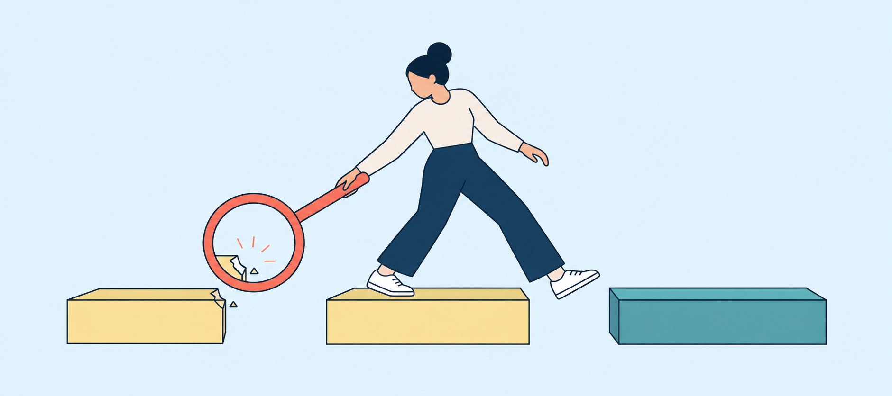

[← 返回总目录](../README.md) · [阅读合并版](../理性生活指南_逐章深度总结.md)

# 第11章深度总结：减少你对失败的极度恐惧

> **范围说明**：本文只依据所给第11章整理。标注为“原书主张”的内容，是对作者观点、案例和治疗思路的忠实转述；标注为“分析”的内容，是为帮助理解而做的机制化重述，不等同于原书原句，也不是对所有临床情形的普遍诊断。

## 一、本章问题

### 原书主张

本章要处理的是第二号非理性信念：

> **“我绝对必须完全做到能干、胜任和有成就；至少，我必须在某些重要方面很有能力或天赋。”**

问题并不在于人希望把事情做好，也不在于成就本身。问题在于，人把“我很想成功”升级成“我必须成功”，再把一次具体表现升级成对整个人的总判决：

- 我做得好，所以我是有价值的人；
- 我失败了，所以我是无能、丢脸、一无是处的人；
- 别人若胜过我，就证明我低人一等；
- 因而，我不能失败，也不能让别人看见我的不完美。

作者认为，这套信念会制造一种悖论：人越把成功当成证明自身价值的必要条件，就越焦虑、越自我监视、越回避风险，也越难充分发挥能力。最终，**对失败的恐惧往往比失败本身更破坏人生**。

### 分析：本章真正要拆开的三个等号

本章反复反对的，不是目标，而是三个未经检验的等号：

1. **表现 = 整个人**：一次写作、谈话、科研或性表现，被当成人格总分。
2. **想要 = 必须**：偏好成功，被升级为绝对命令。
3. **不理想 = 灾难**：损失、遗憾或不便，被夸大成无法承受的羞辱。

只要这三个等号成立，任务现场就不再只是“完成一件事”，而变成“证明我有资格接纳自己”。压力会因此急剧上升。

### 可核查的现实案例：年轻医生萨拉如何停止用“零错误”证明自己

> **案例性质与隐私边界**：以下人物来自心理学家 Alexander Rozental 发表的临床案例说明。论文使用化名“萨拉”（Sara），报告的是同一名来访者的15次认知行为治疗过程；本文不补写论文没有提供的身世或情节，也不把她与其他案例混合。[1]

**人物现场与触发。** 萨拉25岁，刚从医学院毕业，准备去偏远小镇开始实习。初次会谈时，她情绪低落、紧张，谈到处境时会哭，不断看表，也难以安坐。眼前最强的触发，是担心自己达不到同事的水平；研究助理工作中，当她要向团队提交三张由自己负责的数字表格时，脑中立即出现“如果哪里有错怎么办”，并想象同事斥责、失望。[1]

**旧信念：表现不是我做的事，而是我是谁。** 治疗记录显示，她的核心信念是把自我价值建立在成功和成就上，同时要求自己被别人喜欢。由此形成的规则是：事情必须做得完美，不能让周围人失望；犯错会从局部事件迅速升级为“我一文不值”。她后来用一张自我评价饼图看见，学习和工作占了其自我价值来源的75%；于是工作稍有不顺，受损的就不只是“这项任务”，而是整个自我评价。[1]

**回避与保险循环。** 她并非简单地“不做”，而是通过看似负责的行为回避失败感：反复检查、寻求伴侣保证、过度准备、迟迟不决和深夜反刍。提交那三张表格前，她在两小时内约检查五遍；每查一次，焦虑会短暂下降，但回家更晚，仍担心漏错。订旅行机票和酒店时，她能搜索数小时却无法决定，因为害怕选错。课程作业也因必须“完美”而迟迟不能提交。这个循环是：**预测错误将招致贬低 → 检查或求证暂时止痛 → 没有机会知道少检查是否也安全 → 下次更依赖检查。**[1]

**转折：不再争论“我绝不会犯错”，而是把预测交给现实检验。** 萨拉起初曾因过去的辅导被理解成“降低标准”而提前退出；这次治疗没有要求她放弃认真，而是与她共同区分高标准的收益和过量控制的代价。她把完美主义比作运动员过度训练直至受伤，并同意用符合其医学与科研训练的“假设—实验”方式检验旧规则。[1]

**行动。** 第一个实验直击保险行为：提交表格和图形时，不再反复检查到“感觉完全正确”。她预先写下两个竞争预测：A，同事会找出许多错误并对她失望；B，别人不会特别注意。结果，她发送后发现一个小笔误，但没有人表示在意。此后，她继续减少查阅旧病历、反复读邮件和依赖备忘等仪式；向可信任者调查正常的学习时长与工作失误；减少工作时间并安排咖啡休息；做决定后不再向伴侣求保证。她还扩展工作之外的自我评价来源：与朋友和伴侣徒步、重新做饭、跑步时不记录成绩而观察路线和环境。[1]

**结果与局限。** 15次治疗结束时，她能在实习中自行设计新的行为实验，关系因减少求证、提高独立决策而改善。自评量表中，GAD-7从12降至2，PHQ-9从16降至4，“担心犯错”分量表从33降至15；但个人标准只从28降至25。也就是说，改变最大的不是“从此没有标准”，而是对错误的担忧和围绕错误的控制行为。她自己也承认，成就与认可仍然重要，脆弱性可能需要长期处理。论文还指出：这是单一案例说明，不是随机对照试验；未系统评估可能的回避型或依赖型人格模式，复发风险不能排除。[1]

#### 心理机制：为什么少检查反而能降低失败焦虑

1. **条件性自我价值把误差变成人格威胁。** 当“达到卓越标准”成为觉得自己值得的条件，成功会令自我评价上升，失败则令其下降；纵向研究也发现，学业压力与抑郁症状的增加主要同时出现在高度依赖学业能力评价自己的学生中。[2] 萨拉怕的因而不只是一处数字错误，而是错误似乎会证明“我不够好”。
2. **保险行为制造短期缓解，却阻断纠错学习。** 反复检查确实让她当下安心，所以行为被负强化；但她也就无法观察到“没有检查五遍，灾难仍未发生”。完美主义的认知行为模型把检查、求保证、过度准备和回避都视为维持问题的过程。[1]
3. **行为实验产生预测误差。** 暴露研究强调，练习的目标不必是当场把焦虑降到零，而是明确预测一个可观察的坏结果，再让现实结果与预测相遇；“预期违反”越清晰，越可能形成与原恐惧竞争的新学习。[3] 萨拉发现“确有一个小笔误，却无人因此否定我”，这比反复告诉自己“别紧张”提供了更具体的反证。
4. **拓宽身份投资，降低单点故障。** 如果75%的自我价值押在学习和工作上，一次失误就像资产组合中的单一重仓暴跌。徒步、关系、做饭和无计时跑步并非逃避事业，而是在增加其他真实生活领域，使工作反馈不再拥有对整个人的独占解释权。[1]

#### 从案例提炼的解决方案：一次只拆一个维持行为

1. **写下可检验预测**：不要只写“我会失败”，而写“若邮件只检查一遍，会出现多少错误、谁会怎样回应、我认为发生概率是多少”。
2. **识别保险行为**：列出反复检查、拖延提交、过度排练、求保证、只挑有把握任务等动作。它们可能显得认真，却让旧信念免受检验。
3. **设计低风险实验**：减少一种保险行为，而非故意造成重大失误。例如把普通邮件从检查五遍降到一遍；演示只完整排练一次并使用提纲。临床建议同样强调，应先定位具体失败情境及维持它的检查、求证或超时投入，再用实验检验背后的预测。[4]
4. **记录预测与结果的差值**：发生了什么？后果有多严重？即使不舒服，我是否处理得了？重点不是“这次没焦虑”，而是“我在焦虑存在时获得了什么新证据”。[3]
5. **把自我评价分散到多个领域**：定期投入关系、休息、兴趣、照料和公共参与；这些活动不能再被改造成新的绩效竞赛。
6. **逐步变化并守住现实责任**：医生、工程师等高风险工作不能拿关键安全步骤做随意暴露。应从低后果、重复性保险动作开始；如焦虑、抑郁或功能损害持续，应由合格专业人员制定个体化方案。

#### 反事实检验：如果反复检查真是优秀的必要条件

如果旧信念成立，那么萨拉减少检查后应出现更多严重错误、同事明显失望，工作表现持续下降；拓宽生活领域也应让她变懒。实际观察却是：一次小笔误没有引发她预想的人格否定，随后她能在实习中独立使用实验，焦虑、抑郁与担心犯错的评分下降，而个人高标准相对保留。[1] 这不能证明“检查永远没用”或“错误没有后果”；它只推翻更窄、也更关键的命题：**并非所有额外检查都必不可少，一处错误也不自动等于整个人失败。**

访问日期：2026-10-11。

## Sources

[1] https://pmc.ncbi.nlm.nih.gov/articles/PMC7689738 — Beyond perfect? A case illustration of working with perfectionism using cognitive behavior therapy
[2] https://pmc.ncbi.nlm.nih.gov/articles/PMC4611308 — Contingent self-esteem and vulnerability to depression
[3] https://pmc.ncbi.nlm.nih.gov/articles/PMC4114726 — Maximizing Exposure Therapy: An Inhibitory Learning Approach
[4] https://psychwire.com/free-resources/q-and-a/yg1nnd/cbt-for-perfectionism — Q&A with Martin Antony on CBT for perfectionism

## 普通人的真实求助现场

> **案例性质与边界**：以下材料来自普通用户的网络求助及一则社区回应，不是临床访谈、诊断或疗效证据。回应只能代表答题者的理解与建议；现有记录没有说明提问者后来是否采纳建议或发生改变。

### 提问者的处境（节选）

- **index**：64109
- **ques_id**：`3f29f0c7c219aa834b8e96870d70f469`；原题标题：**为什么做什么事情都不敢尽全力？?**。
- **题目**：为什么做什么事情都不敢尽全力？

提问者说，自己“做什么都不敢尽全力”，因为保留一点实力会更有安全感。准备考研时，明知通常需要近一年复习，却故意只留三四个月；这几个月虽然会拼尽全力，但若没考上，便可以告诉自己是“时间不够”，而不是“能力不够”。学跳舞时，一个舞蹈约四节课教完，自己上完前两节、还没练熟，后面的课就不想去；缺席最后两节后，又能安慰自己：“并不是我没有学好。”

提问者清楚这种做法会让自己错过许多体验，却说一想到“拼尽全力还会失败”的挫折和“钻心的痛”，就不敢真正尽全力，并向社区询问如何面对失败。

### 社区回应（节选）

该回应建议先追问：失败为何会带来如此强烈的痛苦？如果一个人把没达到目标解释为能力不足，再把能力不足当成“无能、无价值”的证据，那么成功就会被赋予证明自身存在感的任务，失败也会显得格外可怕。回应进一步指出，留在原地或拖延看似更安全，却会使人为了不让幻想破灭而拒绝投入现实；无论被保护的幻想是“我很差”还是“我其实很有能力”，都需要通过参与现实，才可能获得新的经验。

> **社区非临床边界**：这段回应提出了可理解的心理机制，但没有经过专业评估，不能据此给提问者下诊断；点赞或“推荐”标记也不证明建议一定正确、有效，更不证明提问者已经改善。

### 分析：失败恐惧如何变成自我妨碍

这个现场把本章的循环呈现得很清楚：

1. **失败被解释为能力判决**：如果准备充分仍未考上、课程完整参加仍没学好，提问者担心结果会证明“我能力不够”。
2. **保留能力幻想**：只准备三四个月、主动缺席后续舞蹈课，为失败保留了替代解释——不是“我尽力后仍没做到”，而是“我时间不够”或“我没上完”。于是“如果我真的全力以赴，也许我本可以成功”的想象暂时不必接受检验。
3. **自我妨碍提供短期保护**：缩短准备、拖延和缺席会降低当下被彻底检验的风险，却也真实地减少准备、练习与反馈，提高失败概率。
4. **失败恐惧因此被保存**：因为从未在相对充分投入后观察真实结果，提问者既无法知道自己的实际能力边界，也无法学习“即使尽力后失败，我仍能承受、复盘和继续生活”。保护幻想的动作，同时阻断了修正恐惧的证据。

这里不能简单归结为“懒惰”。从提问者自述看，他在被压缩的考研阶段仍会拼尽全力；关键不是完全不努力，而是预先制造一个可归因的缺口，以免结果成为对整体自我的终审。

### 下一步：只做一个假设练习

先不要求自己立刻“毫无保留地拼一次”，只在纸上写下一个可检验的假设：

> **如果我在一件低风险的小事上按原计划完整投入，结果仍不理想，那么我预测这会证明什么？实际可观察的损失是什么？除了“我能力不够”，还有哪些更局部、可改变的解释？即使最担心的解释部分成立，我下一步仍能做什么？**

这个练习的目的不是保证成功，也不是强迫提问者马上完成考研或舞蹈挑战，而是先把“结果不理想”与“整个人无能”拆开。若这种失败恐惧持续造成明显痛苦或广泛影响学习、工作和生活，可考虑寻求合格心理专业人员的个体化评估；本节不能替代专业帮助。

### 数据来源

本地问答数据：`ques_ans1.json`；index：64109；ques_id：`3f29f0c7c219aa834b8e96870d70f469`。证据类型为提问者自述与社区回答。

---

## 二、具体场景：恐惧如何在生活中伪装成“要求高”

### 1. 有才华却不留下作品：莎拉

**原书场景**：莎拉擅长写作和作曲，却避免群体活动，因为担心自己不如别人。即使创作，她也主要在脑中完成，很少写在纸上，以免作品接受检查。

**原书要点**：她不是没有能力，而是不能容忍能力被检验后可能显得不够好。

**分析**：不落笔让她短期免于评价，却也让作品无法完成、无法获得反馈、无法经练习改进。回避保护了“我或许很有才华”的想象，同时阻断了真实能力的成长。

### 2. 在自己的宴会上反而不会说话：帕特丽夏

**原书场景**：帕特丽夏在别人的聚会上能自然交谈，但在自己的宴会上，因为觉得自己负有“优秀女主人”的责任，反而整晚沉默。

**原书要点**：同一个人、相近的社交能力，仅仅因为加入“我必须表现优秀”的要求，行为就发生了变化。

**分析**：这是一组近乎天然的对照实验。能力没有突然消失，变化的是评价压力。她从“与人交谈”切换成“监考自己的交谈”，有限的注意力开始服务于自我检查，而不再服务于眼前的人。

### 3. 性从享受变成阳刚证明：克里斯与罗伊

**原书场景**：克里斯需要通过性高潮证明“阳刚”；罗伊因担忧不能勃起、会被伴侣看成弱者，而持续出现性功能困难。

**原书主张**：性功能最初可能因疲劳、疾病、工作担忧、吸引力不足或怀孕恐惧等原因受影响；但随后产生的“我又会失败—这太可怕—它证明我无能”的信念，可能让问题持续。焦虑占据注意力，使人远离性刺激和双方的快乐。

罗伊接受的核心调整不是假装勃起“不重要”，而是承认：

- 他确实偏好性交和良好勃起；
- 若未实现，会遗憾、会少一种快乐；
- 但这不是灾难，也不能证明他整个人无能；
- 双方可以把目标转向相互取乐，而非把性交当作唯一终点。

当罗伊真正减少了对勃起的必要性要求、与伴侣坦诚沟通并专注于快乐时，他的快乐和功能都改善了。作者同时强调：如果他只是把“我不在乎”当成恢复勃起的策略，内心仍坚持“我非勃起不可”，这不会奏效。

**分析**：这里的关键不是用另一个技巧操控结果，而是撤掉对结果的绝对要求。否则，“放松”也会变成新考试：“我必须成功放松，以便成功表现。”

### 4. 害怕约会中可能出现的羞辱：卡里

**原书场景**：卡里担心约会时可能受辱、伴侣又不能帮助她抵抗；虽然这种事从未发生，她仍把它想象成可怕的羞辱。

**分析**：她害怕的不只是一个低概率事件，而是自己给事件附加的意义：“若发生，我将颜面尽失，无法承受。”未来的可能性经由灾难化，被提前体验成现实威胁。

### 5. 因怕治疗“失败”而不敢参与治疗：乔纳森

**原书场景**：乔纳森担心不能向治疗师显示聪明，会让治疗也像其他尝试一样成为“彻底失败”，所以在治疗中很少说话。

**分析**：失败恐惧会吞掉本来用于解决失败恐惧的机会。为了避免暴露不完美，他不给治疗提供材料；沉默又降低治疗收益，于是可能被他拿来证明“我果然又失败了”。

### 6. 客观优秀，主观仍像骗子：物理学家本

**原书场景**：25岁的本早早取得博士学位，是多项运动的校队成员，被同事视为顶级物理学家，却因发呆、犯低级错误、写作速度不够快而认定自己虚伪、没有充分利用天赋。他拿自己迟钝的时段与爱因斯坦最杰出的表现比较，并要求自己像一台不停产出优秀思想的机器。

**原书主张**：即使一个人有很高潜力，也没有必须完美实现潜力、永不浪费一分钟的义务。若创造和高产能带来长期快乐，可以追求；但不应借此判定自身价值。后来，本仍认真工作，却不再把失败当作罪行；他更高效、更享受工作，也作出了更有价值的贡献。

**分析**：本的问题不是标准高，而是基准被系统性扭曲：用少数天才的峰值、甚至想象中的持续峰值，审判自己全部时间。只要比较对象是“理想化的别人”，任何现实表现都可被判为不足。

---

## 三、第一性原理：最小机制与因果链

### 1. 最小心理单位

**原书主张可压缩为**：外部事件本身并不自动产生极度恐惧；人对事件所持的绝对化信念，在其中起关键作用。

用本章语言表示：

> **我想做好** → **我必须做好** → **若做不好，就是可怕的** → **这证明我这个人无能、没有价值**

### 2. 从任务到焦虑的完整因果链

**分析性机制图**：

1. 出现一个有不确定性的任务：写作、宴会交谈、约会、性爱、科研或运动。
2. 人本来有一个合理偏好：“我希望做好，并获得快乐、利益或认可。”
3. 偏好被升级成命令：“我必须做好，不能失败。”
4. 任务结果被绑定到整体自我：“表现差 = 我是差的人。”
5. 普通损失被灾难化：“失败会非常羞耻，我受不了。”
6. 注意力从任务本身转向自我监控：“我现在表现如何？别人怎么看？失败迹象出现了吗？”
7. 焦虑上升，专注、自然反应、实验精神和享受下降。
8. 人出现僵住、沉默、回避、拖延、退出或生理功能受抑等结果。
9. 练习和反馈减少，表现更难改善，甚至真的失败。
10. 失败被错误解释为“我果然无能”，于是下一次要求更强、恐惧更大。

这形成一个自我强化回路：

> **必须成功 → 恐惧失败 → 自我监视/回避 → 表现与练习受损 → 更像失败 → 更加必须成功**

### 3. 为什么“给自己更大压力”不一定提高表现

**原书主张**：如果一个人愿意做好项目，又能在失败时无条件接纳自己，他更可能发挥自己的最佳水平，而不是执迷于成为所有人中最优秀者。他会接纳错误、利用错误改进、愿意练习，也愿意承担更多风险。

**分析**：有效压力与身份威胁不同。

- 有效压力问：“这次哪里可以改？”
- 身份威胁问：“这次结果会不会证明我不配？”

前者让注意力流向反馈，后者让注意力流向防御。任务表现所需的认知资源，被“监视自我价值”占用之后，能力可能暂时无法正常调用。

### 4. 为什么成就不能证明一个人的“内在价值”

**原书主张**：成功可以带来快乐、效率、物质、服务、支持和更好的具体表现，但除非通过武断定义，它不能增加人的内在价值；失败也不能降低人的价值。作者主张，人若非要使用“有价值”一词，其资格来自其作为活着的人，而非成就。

作者还借一般语义学提醒：不要轻率地用“是”把人固定为一种东西。一个人会做心理工作、园艺、旅行、阅读、写作等多种活动，不能把职业或某次表现等同于整个人。

**分析**：这里不是证明“每个人的一切表现都一样好”，而是分开两个评价层级：

- 可以评价行为：“这篇文章结构差”“这次实验有错误”“这次表现不达标”；
- 不必把局部评价扩张为人格本体：“所以我是失败者、劣等人。”

行为可测量、可比较、可改进；整个人由无数经历、行为和可能性构成，无法由单项成绩精确总计。

---

## 四、普林斯顿式内心推理路径：当我怕失败时，脑中应该怎样走

下面不是原书逐字对话，而是依据本章观点整理的可跟随推理路线。

### 第一步：先别急着命令自己放松

“我现在很怕。先看看，我怕的是任务损失，还是怕任务给我下人格判决？”

如果只是怕项目做坏，通常会想到准备、练习和修正；如果脑中出现“别人会发现我不行”“我会彻底丢脸”，说明任务已经和自我价值绑在了一起。

### 第二步：把事实与追加解释分开

“事实最多是什么？”

- 我可能说错一句话；
- 作品可能被批评；
- 约会可能不顺；
- 这次科研进度可能较慢；
- 身体可能没有按愿望反应。

“我又加了什么？”

- 这绝不能发生；
- 发生了就太可怕；
- 别人会判定我无能；
- 那就证明我整个人糟透了。

问题的关键出现了：第一组是可能发生的事件，第二组是我施加给事件的绝对化判决。

### 第三步：找到“必须”并降级为强烈偏好

“我当然想成功。成功也确实可能带来快乐和利益。但‘想要’为什么自动等于‘必须’？”

把话改成：

> “我非常希望做好，也会认真准备；但宇宙没有保证我必须做好。若失败，那是不利、遗憾或难堪，不是世界末日。”

这不是降低目标，而是取消目标对人格的生杀权。

### 第四步：只评价这次行为，不评价整个人

“如果这次表现差，准确结论是什么？”

准确结论应当停在局部：

- 我这次准备不足；
- 我现在还不熟练；
- 这个方法没有奏效；
- 我在这种条件下表现不佳。

不要偷换成：“我是无能的人。”我会做许多事，也会在不同时间、条件和任务上表现不同。一次数据点不是整个人。

### 第五步：把注意力送回正在发生的活动

“这个任务本来是为了什么？”

- 写作是把想法写出来；
- 宴会是与人接触；
- 性是双方取乐；
- 科研是探索问题；
- 运动是参与、挑战与享受。

我现在要做的不是证明身份，而是回到下一项可观察动作：写下一段、问对方一个问题、感受刺激、检查一个假设、接住下一球。

### 第六步：预先允许不完美结果存在

“假设最担心的结果真的发生，我是否仍能活下去、学习、再试，或转向其他满足方式？”

若答案是能，那么它也许很糟、很不便，却并非“不可承受”。容许结果存在，才能真正减少结果对注意力的劫持。

### 第七步：事后复盘表现，不审判人格

“哪里有效？哪里无效？下一次练哪一个动作？”

只把错误当信息，而不是罪证。实践减少错误，回避只保存恐惧。

---

## 五、反事实与边界检验

### 检验一：如果本章是在反对高标准，为什么作者仍主张努力精通？

**反事实设定**：假设“放弃必须成功”必然导致懒散，那么本在不再自责后，工作应变差；罗伊不再执着勃起后，性投入也应降低。

**原书结果**：本仍以自己所知的最佳方式完成项目，且更高效、更享受工作、贡献更大；罗伊把注意力转向双方快乐后，快乐和功能反而改善。

**结论**：本章区分的是：

- 高目标、偏好优秀、认真练习；
- 以自我贬低和灾难化逼迫自己。

取消第二项，不等于取消第一项。作者甚至认为，在许多情况下，前者会因后者被取消而表现得更好。

### 检验二：如果表现不定义整个人，是否意味着表现完全不重要？

**反事实设定**：若表现毫无意义，那么考试失败、实验错误、工作低效或性满足缺失都无需处理。

**原书立场**：并非如此。良好表现常带来物质、服务、支持、效率和快乐；性功能困难也确实会使人错过一些快乐。合理反应是遗憾、沮丧、改进和寻求替代满足，而不是把不理想结果变成恐怖事件和人格判决。

**结论**：

> **重要 ≠ 必不可少；遗憾 ≠ 灾难；表现差 ≠ 人格低劣。**

### 检验三：如果我说“不在乎结果”，是否就能解除焦虑？

**反事实设定**：罗伊表面上说“勃起不重要”，心里真正想的是“只要这样说，我就能勃起”。

**原书判断**：这种做法不起作用，因为性交仍被暗中保留为必要目标。“不在乎”只是新的表现技巧，绝对要求没有撤销。

**边界**：理性信念不是否认偏好，也不是自我欺骗。它要求真诚承认：“我很想要，但即使永远得不到，结果也只是不利或不便，而非可怕到无法承受。”

### 检验四：如果无条件接纳自己，是否无需承担错误后果？

**分析**：本章谈的是不把错误升级为对整个人的谴责，并未主张取消现实责任。若表现影响他人、违反规范或造成损害，仍需承认事实、补救、训练或接受后果。区别在于：

- “我做错了，因此我要修正并负责”；
- “我做错了，因此我是一个彻底无价值的人。”

前一句保留责任和行动，后一句容易使人陷入羞耻、逃避或自我惩罚。此处是对原书逻辑的边界化说明。

### 检验五：一天工作14小时一定是不健康的完美主义吗？

**原书边界**：不一定。作者明确说，如果一个人真的比别人更享受工作，那么长时间工作可以是他的偏好。问题在于，他是否以“我永远不能浪费一分钟”“我必须靠产出证明价值”逼迫自己，并牺牲休息、享受和更全面的生活。

**结论**：不能只看工作时长判断完美主义，要看驱动力是喜爱与选择，还是身份恐惧与强迫性要求。

---

## 六、容易误解之处

### 误解1：“不评价自己”就是不能评价表现

**纠偏**：原书反对的是用单项表现给整个人定性，不是反对具体、严格的绩效判断。你仍可说“这次没有达标”，但不必说“所以我一无是处”。

### 误解2：“无条件接纳自己”就是认为自己什么都好

**纠偏**：接纳易错的人性，不等于赞同每个行为。人可以同时做到：承认错误、承担后果、努力改进，并拒绝把自己全盘贬低。

### 误解3：“追求快乐”就是只顾即时享乐

**纠偏**：作者在与本的对话中明确谈到“大部分人生”的长期享受，而不是片刻冲动。如果高生产力是长期满足的最佳路径，可以选择它；但要检验它是否真带来长期满足，而非由自责驱动。

### 误解4：“比较没有意义”就是无需参考他人

**纠偏**：别人可以作为技术、标准或策略上的参照。危险在于把比较变成价值排序：“他做得比我好，所以他是更好的人，而我是劣等人。”比较表现可以产生信息，比较人格总价值只会制造持续不安全。

### 误解5：“失败不可怕”就是失败没有代价

**纠偏**：原书并不否认不利、损失、尴尬和遗憾。它反对把这些代价扩大为“最糟糕的罪行”“无法承受的羞辱”或人格毁灭。

### 误解6：“表现焦虑都只是想法造成的”

**纠偏**：原书在性功能例子中明确承认，最初的功能问题可能来自疲劳、疾病、工作压力、吸引力或怀孕恐惧等多种原因。作者强调的是：灾难化和自我贬低可能让原问题持续或加重，而不是断言所有问题只有一个心理原因。若有持续身体或功能问题，本章不能替代专业医疗评估。

### 误解7：“只要改一句自我对话，问题就会立刻消失”

**纠偏**：本与治疗师经历了艰难的治疗“战斗”；作者也强调真正说服自己，而非口头假装。信念改变需要反复辩论、行为实践、承担风险和从经验中学习。

### 误解8：“不必实现潜力”就是浪费天赋

**纠偏**：作者不反对创造冲动或发挥能力，只反对把潜力变成道德债务。你可以因为热爱、挑战和创造的快乐去“攀登高峰”；不必为了站在峰顶向下证明自己比别人高贵。

---

## 七、可执行练习

### 练习1：把“必须”抓出来

选择一个最近让你焦虑的任务，写下脑中最强的三句话，例如：

- 我必须表现得很聪明；
- 我绝不能出错；
- 别人若不满意，就证明我没有能力。

然后逐句改写：

> “我强烈希望____，因为它会带来____；但我并非必须做到。若没做到，最准确的后果是____，而不是____。”

例：

> “我强烈希望演讲清楚，因为这能帮助听众理解；但我并非必须毫无错误。若卡顿，会有些尴尬并影响表达，而不是证明我是一个无能的人。”

### 练习2：事件—解释双栏

每次恐惧出现，写两栏：

**可观察事实**
- 对方沉默了十秒；
- 我写了一页后删掉；
- 这次结果低于目标；
- 身体没有按愿望反应。

**我追加的判决**
- 他一定觉得我愚蠢；
- 我永远写不好；
- 我彻底失败；
- 我不是真正的男人/女人。

只对第一栏制定行动；对第二栏进行质疑。

### 练习3：局部语言训练

连续一周，禁止使用笼统身份标签来描述失败，如“我是废物”“我是骗子”“我是失败者”。改用含时间、条件和行为的句子：

- “我今天下午注意力不集中”；
- “我目前还不会处理这类问题”；
- “这次准备方式效果差”；
- “我在高评价压力下容易沉默。”

目的不是美化事实，而是提高描述精度，使问题变得可处理。

### 练习4：故意做一次低风险、不完美的尝试

选择后果可控、但你一直因怕丢脸而回避的事：

- 在会议中问一个可能不够成熟的问题；
- 把一页未完美的草稿交给可信任的人；
- 参加一次自己并不擅长的群体活动；
- 与伴侣坦诚讨论表现压力，把目标改为共同体验。

行动前写：最坏的现实后果是什么？我会如何应对？

行动后只记录：实际发生了什么？我承受住了吗？获得了什么反馈？

### 练习5：把结果目标改成过程目标

将“必须成功”的目标转换成可执行动作：

- “必须写出好文章” → “今天写300字可见草稿”；
- “必须让所有宾客喜欢我” → “主动问三个人一个真实问题”；
- “必须表现完美” → “完成一次尝试并记录一个可改进点”；
- “必须证明性能力” → “持续注意双方觉得舒服、有趣的刺激与反馈”。

过程目标不是保证结果，而是把注意力从人格审判送回任务。

### 练习6：失败后的三句复盘

每次不达标，只写三句：

1. **事实**：这次具体哪里没达到目标？
2. **学习**：它提供了什么信息？
3. **接纳**：这说明我的一次行为有限，不说明我整个人无价值。

随后安排一个最小的再次尝试，用实践而不是反刍减少错误。

### 练习7：登山动机审计

针对一个高目标问自己：

- 如果没人知道，我还愿意做吗？
- 我是在享受攀登、挑战和风景，还是主要想证明自己高于山下的人？
- 若最后没有登顶，这段过程是否仍有价值？
- 我能否认真攀登，同时允许自己是会累、会慢、会失败的凡人？

这对应本章结尾的比喻：可以因热爱、挑战和风景登山，不必为了在高处向下吐唾沫。

---

## 八、一句话触发器

> **当我脑中出现“这次必须成功”时，立刻问：我是在改进一项表现，还是在拿这项表现审判整个人？**

## 九、本章压缩结论

### 原书主张

人可以强烈偏好成功、维持严格但可实现的目标、努力精通并享受成就；但不必要求自己完美，也不必通过胜过别人证明价值。失败可以令人遗憾和沮丧，却不必成为灾难，更不能把一个会犯错的人变成“一无是处的人”。当人愿意失败而仍接纳自己时，往往更能练习、冒险、享受活动，并发挥实际能力。

### 分析性总结

本章提供的不是“降低标准”，而是一次评价系统的重构：

> **把价值从结果中解绑，把注意力从自我监考送回活动，把错误从罪证改成反馈。**

这样做未必保证成功，却会减少那种因“非成功不可”而制造的二次失败。

---

[← 返回总目录](../README.md)
